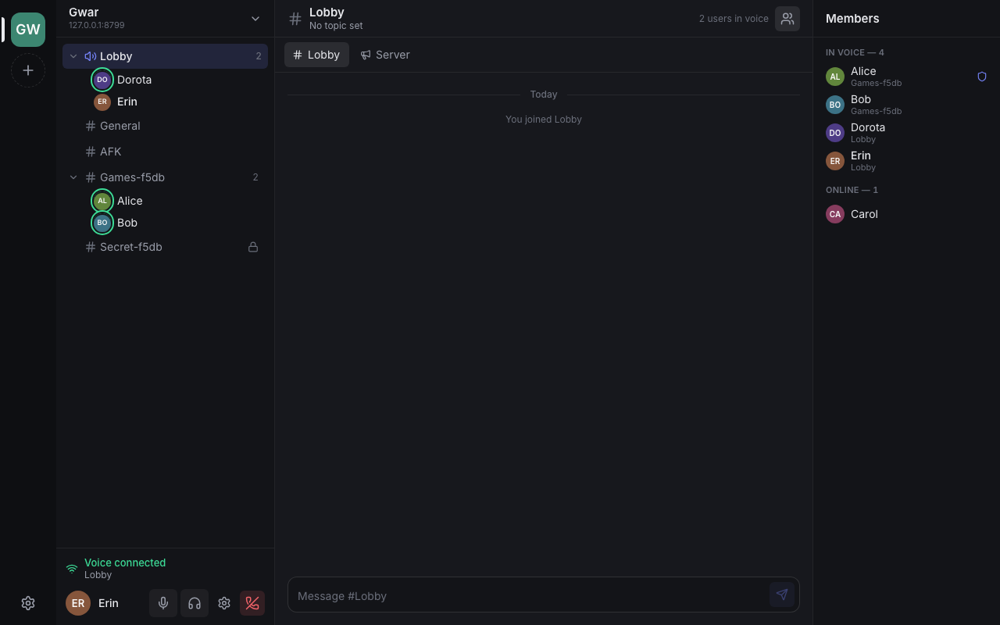

# Gwar

**Gwar** is an open-source, self-hosted voice chat. Run your own server,
talk from the browser or the desktop app, and keep your friends who still use
TeamSpeak in the same conversation. It is built to stay trustworthy even when
the server you join is not: your identity is a key only you hold, and Gwar
clients sign what you write (see [Security](#security)).

**Use it:** the official web app at <https://gwar.app> and the desktop app
connect to any Gwar server. The project also runs a public server that anyone
can use for free: type `gwar.app` in Gwar or in a TeamSpeak client.

*Gwar* is Polish for the buzz of many voices talking at once.



## Why

TeamSpeak works, but it moves slowly and its newer clients are hard to use.
Discord is polished, but it is a closed service you cannot host yourself.
Gwar aims for the middle: a server you own, a modern and simple interface, and
no lock-in, including compatibility with the TeamSpeak ecosystem people already
use.

## What it does today

- **Voice with very low latency.** Opus is forwarded by a WebRTC SFU without
  being decoded or re-encoded; the server only decides who hears whom.
- **Always on, like Discord.** You stay connected to a server without being in
  voice: read and write any channel's chat, see who is in which voice channel,
  join voice when you want to talk. Unread counts follow you across devices.
- **Channels and chat.** Nested channels, passwords, user limits, channel
  history kept on the server (the latest 1,000 messages per channel), live
  private and server-wide messages, a member list with online and offline
  users.
- **Chat like you expect.** Mentions with notifications, editing and deleting,
  images, video, audio and files (drag and drop or paste).
- **Your identity is a key, not an account.** Every client holds an Ed25519
  key; it works on any Gwar server without signing up anywhere.
- **Optional Gwar Connect account** to be the same person on the web, the
  desktop and (later) the phone. Connect never sees your password or your
  key: it stores your identity encrypted, each device gets its own key
  certified by your identity, and a lost device is revoked without changing who
  you are. Your saved servers follow you to every device. Servers verify
  devices themselves and keep working if Connect is down. See
  [docs/connect.md](docs/connect.md).
- **Signed chat.** Gwar clients sign every message, edit, deletion and
  attachment and verify everyone else's, so a server cannot put words in a
  Gwar user's mouth without a warning. See [Security](#security).
- **Moderation.** Roles with any permissions and colors, bans (timed or
  permanent, by identity or IP), invite links that can grant a role, server
  settings, removing members and cleaning up the inactive ones. Nobody can hand
  out more than they hold.
- **One web app, plus a desktop app, with one UI.** The project hosts the web
  app; it connects to any server. The Tauri 2 desktop app has a native audio
  engine (Opus with FEC, jitter buffer with loss concealment), global
  push-to-talk and a tray icon. English and Polish.
- **TeamSpeak in both directions.**
  - Official TeamSpeak 3 and 6 clients can join a Gwar server (optional, see
    below). They see the same channels and people, and talk and chat with
    everyone else.
  - The desktop app can connect to any existing TS3/TS6 server with the same
    interface.

Gwar is early software: it works and is tested end to end, but expect rough
edges and breaking changes.

## Security

Gwar starts from the assumption that everything is public: the code, the
protocol, and possibly a modified server you join by mistake. Nothing depends
on hidden behavior; security comes only from keys that never leave their owner.
A server is trusted to route voice and deliver messages, and today it can read
them, but it is never trusted with who you are: even a hostile server cannot
log in as you elsewhere, forge your messages or show a fake verified name
without a visible warning.
The limits are listed plainly [at the end](#what-gwar-does-not-protect-yet).

### Your identity is a key

- Every identity is an **Ed25519 key pair generated on your device**. Your uid
  is a hash of the public key and your `#tag` comes from the uid, so nobody, not
  even a server operator, can choose, take or fake them.
- Joining a server needs no account, e-mail or sign-up anywhere.

### Logging in: mutual proof, no relaying

- Every server has its own **Ed25519 server key**. Invite links carry its full
  fingerprint, and clients pin it for each server address. Without an invite,
  the first connection trusts the key it is shown (as SSH does) and pins it.
  If the key later changes, login stops until you check it with the owner;
  there is no silent rotation and no fallback to a weaker login.
- Login is a **mutual challenge-response**: your client signs the exact address
  it dialed, the server key it expects and fresh random values from both sides,
  and the server must answer with a proof signed by its own key. A malicious
  server cannot replay your login to another server, and cannot pretend to be a
  server whose key it does not hold.
- Server passwords and invites are sent only after the server has proven itself.
- These guarantees need TLS and a server that lists its real addresses. The
  plaintext LAN option and the development flag `--insecure-any-host` give
  them up, and say so.

### Encrypted connections

- Everything travels over **TLS** (`https://`, `wss://`); the server can obtain
  and renew Let's Encrypt certificates by itself.
- Voice uses **WebRTC, encrypted with DTLS-SRTP**.
- Plaintext is allowed only to loopback for development, or through an explicit
  per-server LAN option in the desktop app, which shows a permanent red warning
  while connected.

### Every message is signed

- Each message, edit, author deletion and attachment written in Gwar is
  **signed by its author's key** and bound to the server's key, the
  conversation and the message id. A server cannot alter such a message, move
  it to another channel id or present it as someone else's without clients
  noticing. The signature names the channel by id, not by its name.
- **Edits form a hash chain.** Clients keep up to 10,000 local checkpoints
  that catch rollbacks and forks of messages they have already seen; a fresh
  device, cleared storage or a checkpoint that was evicted has nothing to
  compare against.
- Attachments are **checked against their signed hash** before they are shown
  or saved; one that fails or has no signature loads only when you ask.
- Until its signature is checked a message is visibly pending; anything that
  fails or cannot be fully verified carries a warning. Notifications and
  mention highlights for Gwar messages need a verified signature. TeamSpeak
  messages cannot be signed: they still notify, labeled as TeamSpeak, and
  removals by moderators are labeled as the server's.

### Gwar Connect: an account that never sees your secrets

- **Your password never leaves your device.** It is stretched there with
  **Argon2id** (64 MiB, 3 passes) into two keys: one encrypts your account key
  with **AES-256-GCM**, the other signs you in, and Connect keeps only an
  Argon2 hash of it. A leaked Connect database holds no usable credentials;
  an attacker would have to guess each password offline, which is slow by
  design but succeeds against weak passwords. Choose a strong one.
- A **recovery code** with 160 random bits, shown once, restores access if you
  forget the password.
- Every device has **its own key, certified by your account key** for at most
  90 days. A lost device is revoked with a signed revocation, and you stay the
  same person. Servers check for revocations every five minutes and then
  disconnect the device. If Connect withholds a revocation, the device works
  until its certificate expires; revoking it cannot take back what it already
  copied.
- Your **vault** (profile, TeamSpeak identities, saved servers with their
  passwords) is encrypted on your devices with AES-256-GCM under a key derived
  from your account key; Connect stores only ciphertext.
- An `@handle` badge is a **signed attestation** that your client checks
  against the key of its own Connect service, so a server cannot invent one.
  Servers verify devices themselves and keep working when Connect is down.

### Hardened against hostile input

- Clients validate every server message, with size and count bounds, before
  using it. Servers limit frame sizes before parsing and rate-limit
  connections that have not logged in yet.
- The web app and the desktop interface run under a **Content-Security-Policy**.
  Uploaded files are served with a sandboxing CSP and `nosniff`, and only from
  the server's own origin.
- Images are decoded only near the visible part of the chat and within a memory
  budget; an image that decodes larger than its header claims is dropped.
- Storage is capped per member and in total, so free identities cannot fill the
  disk.

### What Gwar does not protect, yet

Being honest about the limits is part of the design:

- **The server you are on can read its content**: messages, direct messages,
  files and voice. Nothing is end-to-end encrypted yet; voice goes through the
  server (an SFU). For private conversations, use a server you trust, or run
  your own. End-to-end encryption is designed in [docs/e2e.md](docs/e2e.md)
  and not built yet.
- Voice is not signed, and presence, nicknames, channel names and roles are the
  server's word. A server can also hide, delay or reorder messages.
- **File links are like keys** by default: anyone holding a file's link can
  download it without logging in, also after leaving the server, until the
  message is deleted. TeamSpeak users need that to open files posted on Gwar.
  A server admin can make files members-only instead: then only people
  connected to the server who can read the channel open them, and TeamSpeak
  users see only file names.
- Gwar Connect vouches for `@handle`s. Your client notices when a handle it
  already knows moves to a different account, but not on first sight, and
  Connect could serve you an older copy of your encrypted vault.
- The web app runs the code its host serves on every load (see
  [The official web app](#the-official-web-app)). Desktop builds are not
  code-signed by Apple or Microsoft yet; their checksums are signed with the
  release key (see [Download](#download)).
- TeamSpeak users have no Gwar keys, so their messages are shown as unsigned.

### By design

These are deliberate, not missing features:

- **A server sees your IP address**, when you are online and how much you
  send, like any service you connect to. Encryption protects what you say,
  not the fact that you connect. Gwar Connect, if you use it, sees when your
  devices sign in and sync.
- **Your uid is the same on every server.** That continuity is the point: your
  identity, your signatures and your `@handle` carry over everywhere, so
  servers that compare notes can tell it is you, with or without a handle.

### The official web app

<https://gwar.app> is the only official Gwar web app. It connects to any
self-hosted Gwar server, so server operators do not need to host a web client.

- The web app runs the code gwar.app serves on every load. Whoever controlled
  its hosting or deployment could serve modified code that reaches your keys,
  your password and your messages; signatures (and, later, end-to-end
  encryption) assume your client is genuine.
- gwar.app loads no third-party scripts, runs under a strict
  Content-Security-Policy, and publishes the commit it was built from at
  <https://gwar.app/version.json>.
- Copies of the web app hosted anywhere else are run by someone else; entering
  your Connect password there trusts them with it.
- The desktop app bundles its interface and never loads it from gwar.app.
  Download it from the [releases](#download) of this repository.

The full threat model, with every mechanism and its limits, is in
[docs/security.md](docs/security.md).

## Names: nickname, #tag and @handle

A member is shown as **nickname** `@handle #tag`, for example
**Dominika** `@dominika #kd5wx7rmq2`.

- **Nickname**: what people see in chat and in the member list. It is chosen
  per server and the same on all your devices. Two people may have the same
  nickname. Your identity has a global nickname (a random `gwar-#####` at
  first, change it in Settings → Identity). A server uses it only the first
  time you join. After that, change it on that server with *Change nickname*.
  Roles with the *Change member nicknames* permission can rename others.
  History always shows the current nickname.
- **#tag**: derived from your identity key (lowercase base32 of the uid). The
  server uses the shortest prefix that is unique on that server, at least
  10 characters. Nobody can choose it, change it or take someone else's,
  and every identity has one, with or without an account. Use it to tell apart
  people with the same nickname. The mention picker shows it too.
- **@handle**: your [Gwar Connect](docs/connect.md) account name, shown with a
  verified badge. Your client checks Connect's signed attestation itself,
  against the key of its own Connect service and the member's uid, so a server
  cannot invent one. Handles refresh in the background and an expired one is
  hidden (details in [docs/connect.md](docs/connect.md)). Your client remembers
  which account it saw behind each handle: if the same handle later shows up on
  a different account, it is marked as changed instead of verified until you
  accept it in the member's profile. A handle is only as trustworthy as
  Connect, while the #tag needs no one.

## Download

Prebuilt apps are on the [GitHub Releases page](https://github.com/MaciejWlodarski/gwar/releases):

- **Desktop app:** macOS (universal `.dmg`), Windows (`.exe` or `.msi`) and
  Linux (`.AppImage` or `.deb`). Builds may be unsigned: macOS and Windows then
  warn at the first start, and [docs/releasing.md](docs/releasing.md) shows how
  to open them anyway.
- **Server:** `vc-server` and `gwar-connect` for Linux x86-64 and ARM64
  (`gwar-server-*.tar.gz`), so you do not need Rust to run your own. Unpack and
  continue with "Run a server" below, using `./vc-server` instead of
  `./target/release/vc-server`.

`SHA256SUMS` on each release lists the checksum of every other file, and
`SHA256SUMS.minisig` signs it with the release key in
[docs/release-key.pub](docs/release-key.pub). The built files and
`SHA256SUMS` also have a GitHub build attestation naming the workflow and
commit that built them. How to check a download:
[docs/releasing.md](docs/releasing.md#verify-a-download), which also describes
how a release is made.

## Run a server

You run only the server; people connect with the official web app or the
desktop app. The web app is served over HTTPS, so browsers can only reach
servers that have HTTPS too, which the server can do on its own:

```bash
cargo build --release -p vc-server
./target/release/vc-server --data-dir data --domain voice.example.com --acme-email you@example.com
```

With `--domain` the server gets a certificate from Let's Encrypt and renews it
by itself (it answers the challenge on port 443, so nothing else is needed),
listens for HTTPS on 443 and redirects plain HTTP from port 80. Open
**TCP 443** (and 80 for the redirect) and **UDP 9987** for voice. Already have a
certificate or a reverse proxy? Use `--tls-cert`/`--tls-key`, or plain HTTP on
`--http` behind your proxy. `--public-ip` sets the address announced for voice
when the server is behind NAT.

Other useful options: `--max-clients` (128 by default), `--server-password`,
`--ice-servers` (a JSON file of TURN servers for clients behind strict
firewalls), and upload limits `--upload-limit-mb` (25 MiB per file),
`--upload-quota-mb` (1 GiB per member) and `--storage-limit-mb` (10 GiB in
total). Every option also has a `VC_…` environment variable;
`vc-server --help` lists them all.

On first start the server prints a one-time **admin token**; open the web app,
connect to `voice.example.com` and redeem it from the server menu ("Use
token"). Get another one with `vc-server --data-dir data admin-token`.

Connections are encrypted by default: plain `ws://` works only to loopback for
development, or through the desktop app's explicit LAN option (see
[Security](#encrypted-connections)).

### Addresses clients log in to

A login signature covers the exact address the client dialed (scheme, host,
port and path), so the server accepts only the addresses you configure:

- `--domain`: `wss://<domain>/ws` for each domain;
- `--public-url`: the same host and port as `ws(s)://…/ws`;
- `--public-endpoint`: any full address, repeatable, including alias paths
  (or comma-separated `VC_PUBLIC_ENDPOINTS`);
- `--public-ip`: a global unicast IP adds `wss://<ip>[:port]/ws` with the
  actual listening port (omitted for 443), but only when the server terminates
  TLS itself (behind a proxy use `--public-url` or `--public-endpoint`).
  Browsers need a certificate valid for that IP.

The server refuses to start without any. Addresses are compared in canonical
form (lowercase host, IPv6 in brackets, no default port, credentials, query
or fragment); request headers never add one, and private, loopback and
link-local IPs are never added automatically. For local development, list
loopback explicitly:

```bash
vc-server --public-endpoint ws://127.0.0.1:8790/ws
```

`--insecure-any-host` (`VC_INSECURE_ANY_HOST`) accepts any address with a loud
warning. It gives up the protection against relayed logins, even for pinned
servers, so use it only for isolated development and tests.

### Behind a reverse proxy

Set the public URL and the header your proxy puts the client's address in:

```bash
vc-server --http 127.0.0.1:8800 --public-url https://voice.example.com --client-ip-header x-real-ip
```

With nginx that is `proxy_set_header X-Real-IP $remote_addr;`. The header is
believed only from loopback, so name one the proxy always overwrites.

### Server key and backups

On first start the server creates `server-key.ed25519` in its data directory
(an Ed25519 seed, mode 0600 on Unix). It is the server's identity: clients pin
it, and invite links and the server menu's **Server key** show its
fingerprint, the full public key (`vc-server --data-dir data server-key`
prints it). **Back it up with the database and never share it**; with a new
key clients see a new server and have to confirm the change with you.

Back up the database while the server runs with
`vc-server --data-dir data backup copy.sqlite3`.

### Gwar Connect

Servers accept Gwar Connect devices out of the box. Every five minutes they
fetch the list of revoked devices from the official Connect service, and they
confirm handles in the background (daily, sooner after a failure).
`--connect-url` points to another Connect service; `--no-connect` turns both
off and clears the handle cache.

### Removing members

Admins (or anyone with the "Remove members" permission) can remove a member
from the member list, or clean up people not seen for a while in Server
settings. Removing is not a ban: the member's record, roles and read marks go
(their messages and files too, if asked) and they can join again as a new
member. The same works from the command line, straight on the database:

```bash
vc-server --data-dir data members list [--inactive-days 90]
vc-server --data-dir data members prune --inactive-days 90 --dry-run
vc-server --data-dir data members prune --inactive-days 90 [--include-grouped] [--delete-messages]
vc-server --data-dir data members remove [--delete-messages] [--dry-run] -- <uid>...
vc-server --data-dir data members merge [--dry-run] -- <from-uid> <into-uid>
```

- `list` (with each member's tag and confirmed handle) and the `--dry-run` of
  `prune` and `remove` are safe while the server runs. A real `prune` or
  `remove`, and `merge` even with `--dry-run`, need the server stopped: it
  holds `data/vc.lock`, and the commands refuse to run while it does.
- `prune` keeps members with a role besides Member unless `--include-grouped`
  is given.
- `merge` moves one identity's unsigned messages (and the mentions in them),
  uploads, roles, read marks, UID bans and the invites and admin tokens it
  created to an existing member, in one transaction, keeping the target's
  nickname. Signed messages keep their original author and mentions, because
  the signature binds them; the counts it reports cover only unsigned
  messages and mentions.
- Put UIDs beginning with `-` after `--`, as in the examples above.

## Develop

Requirements: Rust (stable), Node 22+, pnpm (the version pinned in
`package.json`), and libopus for the native clients
(`brew install opus` or `apt install libopus-dev libasound2-dev`).

```bash
pnpm install
cargo run -p vc-server -- --data-dir data --public-endpoint ws://localhost:8790/ws --public-endpoint ws://127.0.0.1:8790/ws --public-endpoint ws://localhost:5173/ws --public-endpoint ws://127.0.0.1:5173/ws
pnpm --filter web dev                            # web app on http://localhost:5173
pnpm --filter desktop dev                        # desktop app
```

`--web-root apps/web/dist` makes the server serve a built web app itself (handy
for development or a private network). Uploads from a web app on another
origin are allowed for the official web app and for `--web-origin` entries.

Microphone permission on the desktop app: macOS asks on first use (the bundled
app carries `NSMicrophoneUsageDescription` and the audio-input entitlement), and
Windows or macOS users who blocked it get an "Open privacy settings" button.
`tauri dev` runs an unbundled binary, so macOS attributes the prompt (and the
System Settings entry) to the terminal you started it from; test the real flow
with `pnpm --filter desktop build`. To reset a decision while testing:
`tccutil reset Microphone app.gwar.desktop`.

## TeamSpeak compatibility

Official TeamSpeak clients only accept servers that hold a license issued by
TeamSpeak, so Gwar does not imitate a TeamSpeak server. Instead, with
`--teamspeak --accept-teamspeak-license` it downloads the official TeamSpeak 3
server from TeamSpeak (checksum-verified), runs it as a hidden child process
and bridges it:

- channels, the server name and the welcome message are managed by Gwar and
  mirrored to TeamSpeak;
- TeamSpeak users appear in Gwar like everyone else, with a TS3/TS6 badge;
- a Gwar user who shares a channel with TeamSpeak users (or chats with one
  privately) gets a stand-in client on TeamSpeak, so TeamSpeak users see, hear
  and message them; everyone else is listed in the channel description. Voice
  crosses the bridge as Opus, without being decoded or re-encoded.

TeamSpeak clients connect to `your-host:9987` (UDP); Gwar's WebRTC voice then
moves to 9988, so open both ports, and TCP 30033 for TeamSpeak file transfer
(icons, avatars, channel files; `--teamspeak-filetransfer` moves it). On ARM64 hosts the x86-64 TeamSpeak server
runs under emulation (`apt install qemu-user libc6-amd64-cross
libstdc++6-amd64-cross`, or box64). Only one free-licensed TeamSpeak server may
run per machine.

**License note.** The TeamSpeak server is third-party software under its own
license, which you accept when enabling this option; Gwar does not ship it.
Its free license allows 32 slots (TeamSpeak users plus Gwar stand-ins) and is
for **non-commercial use only**; commercial operators need a license from
TeamSpeak. Gwar's own limit is `--max-clients`, independent of TeamSpeak's
slots. Gwar is not affiliated with TeamSpeak. TeamSpeak support is a cargo
feature (`teamspeak`, on by default); build without it with
`--no-default-features`.

## Project layout

| Path | What it is |
| --- | --- |
| `crates/vc-server` | Server: core (state, permissions, SQLite), WebSocket gateway, WebRTC SFU, TeamSpeak bridge |
| `crates/vc-proto` | The `vc/3` protocol (Rust types, generated TypeScript types) |
| `crates/vc-client` | Native client: protocol, voice engine, TeamSpeak mode |
| `crates/gwar-connect` | Gwar Connect, the optional account service |
| `apps/web` | The shared UI (React): the hosted web app and the desktop app's UI |
| `apps/desktop` | Tauri 2 desktop app: native voice, global push-to-talk, tray |
| `scripts/deploy-vm.sh` | Deploys the server and Connect to a Linux host over SSH |

More in [docs/architecture.md](docs/architecture.md), [docs/connect.md](docs/connect.md),
[docs/security.md](docs/security.md), [docs/deploy.md](docs/deploy.md),
[docs/releasing.md](docs/releasing.md) and, for what comes next,
[docs/e2e.md](docs/e2e.md).

## Tests

```bash
cargo test --workspace          # includes end-to-end WebRTC voice tests
pnpm --filter web test          # UI unit tests
pnpm --filter web e2e           # Playwright: two users against a local server and Connect
VC_TS3_DIR=/tmp/ts3 cargo test -p vc-client --test teamspeak_mode --test teamspeak_interop -- --test-threads=1
                                # against the real TeamSpeak server (downloaded into VC_TS3_DIR)
```

## Roadmap

- **Steadier connections and even lower latency**, the next focus: voice
  should feel at least as immediate as on TeamSpeak.
- **End-to-end encryption**: channel chat, direct messages, server-wide chat
  and their files with MLS, voice with SFrame. Encrypted direct messages and
  server-wide chat are stored as ciphertext, so they reach you after you were
  offline. Encryption is chosen when a channel is created, with or without
  history for new members, and your history follows you to your devices
  through Gwar Connect. Channels shared with TeamSpeak users stay unencrypted
  and are labeled as such. Design: [docs/e2e.md](docs/e2e.md); prototypes
  are in progress.
- **Mobile app** (iOS and Android).
- **Streaming**: screen sharing and video, peer to peer and through the server.
- **Better audio on desktop**: noise suppression and echo cancellation.
- **Fully native clients** later, keeping the same protocol.
- **More TeamSpeak options**: bring your own TeamSpeak license for more slots,
  and a mixed stand-in so Gwar users can still talk when the free slots run out.

Ideas and pull requests are welcome; open an issue to discuss bigger changes.

## License

MIT, see [LICENSE](LICENSE). Third-party components keep their own licenses,
see [THIRD_PARTY_NOTICES.md](THIRD_PARTY_NOTICES.md).
