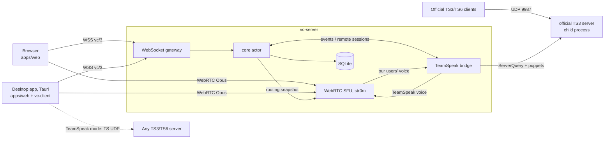

# Architecture



## Deployment model

People run **servers**; the project runs the **web app** (one origin, today
`https://gwar.maciejwlodarski.com`, see `OFFICIAL_WEB_ORIGIN`), which connects
to any server over `wss://`. Hence servers need HTTPS: `--domain` gets and
renews a Let's Encrypt certificate inside the server (`src/tls.rs`), and
uploads accept cross-origin requests from the web app's origin only (CORS on
the file routes; uploads are authorized by one-time tokens, not cookies). The
desktop app connects anywhere, with TLS by default. Plaintext LAN requires an
explicit per-server desktop opt-in and a persistent red impersonation/session-takeover warning; loopback
is the development exception.

## Principles

- **One owner of state.** `core` is an actor (a single tokio task): every
  change to channels, users and permissions goes through it in order, so every
  client sees the same sequence of events, without locks. Transports
  (WebSocket, TeamSpeak) are thin: they translate to `vc/3` and back.
- **Audio is never decoded on the server.** Opus frames are forwarded as they
  are (SFU). The server only decides *who hears whom*, from a routing snapshot
  the core publishes (`ArcSwap`, lock-free reads). Clients decode and mix
  themselves (TS3 does it natively; browsers and the desktop app have 8 fixed
  receive "slots" assigned to active speakers).
- **Speech gate on the server.** Browsers send their audio level (RFC 6464);
  the server drops silence, drives the "talking" indicator and ends talk spurts
  for TeamSpeak clients.

## The `vc/3` protocol

JSON over a WebSocket (`/ws`). The full, commented definition is
[`crates/vc-proto/src/lib.rs`](../crates/vc-proto/src/lib.rs); the TypeScript
types are generated with `cargo test -p vc-proto --features ts`.

1. Server: `challenge {protocol: 3, server_pk, server_nonce, server,
   password_required}`. The metadata helps the connect UI; only the key and
   nonce enter the transcript. The client checks the candidate key against its
   endpoint pin or invite fingerprint **before signing**.
2. Client: `hello {protocol: 3, endpoint, expected_server_pk, server_nonce,
   client_nonce, client_signing_pk, certificate?, certificate_hash, signature,
   nickname, client}`. The server verifies its configured endpoint allowlist,
   its own key, the connection nonce, the client signature, certificate
   commitment and current certificate/revocation authorization. Nickname and
   software are application metadata outside H.
3. Server: hello reply `{server_proof}`. The client reconstructs H locally and
   verifies the proof under `expected_server_pk`, then commits its first-contact
   pin. Missing proof, changed transcript, malformed encoding or wrong protocol is
   fatal; no legacy fallback.
4. Client: `join {server_password?, invite?}` on the same connection, **only
   after proof verification**. Hello rejects these secret fields. The server
   rechecks device validity and authorization and grants a session only when
   join succeeds. Its reply is `Welcome` (server state, channels, clients,
   members, unread counts, permissions and ICE servers). No application
   request is accepted before this point.
5. Requests `{"id", "op", "d"}` → `{"re", "ok" | "err"}`; events `{"ev", "d"}`.
   `voice.offer` negotiates WebRTC; `voice.slot` identifies its receive slots.

The endpoint is the client's locally constructed canonical external WebSocket
URL: WS(S) scheme, lowercase host without a trailing dot, bracketed IPv6,
effective port omitted at the scheme default, and exact path. No credentials,
query or fragment. Rust and TypeScript share normalization and transcript
vectors in `crates/vc-proto/tests/endpoint-normalization.json` and
`handshake-v3.json`. The path and scheme are part of the binding, so a signature
cannot be relayed to another accepted alias endpoint.

Only configuration supplies accepted endpoints: every `--domain` gives
`wss://<domain>/ws`; `--public-url` maps its scheme to WS(S), retains host/port
and uses `/ws`; repeatable `--public-endpoint` supplies full endpoint URLs.
An explicitly configured global unicast `--public-ip` adds
`wss://<ip>[:port]/ws` only when vc-server terminates TLS itself, using the
actual listener port (omitted only for 443). Behind a reverse proxy, configure
`--public-url` or `--public-endpoint`; the external scheme and port are unknown.
Private, loopback and link-local addresses never auto-authorize login. Request
headers cannot expand the set. An empty set refuses startup, unless the
explicit **isolated development/test-only** `--insecure-any-host` disables
this check and logs a loud warning.

The server's Ed25519 seed is generated once, persisted atomically as
`server-key.ed25519` in its data directory (0600 on Unix), and never logged.
`vc-server --data-dir <dir> server-key` prints the public key. Back up the seed
with the database; losing it changes the authenticated server epoch.
The web/desktop client keeps `{server_pk, first_seen}` in localStorage under
`vc.server-pin:<canonical endpoint>`. TOFU without a pin or trusted invite
identifies a first-contact candidate; proof verification precedes pinning.
Invite links include `server_key=<full public key>`, which must match the
challenge. A pin mismatch is a blocking English/Polish dialog with both keys
and an explicit dangerous forget-and-trust action. An invite mismatch blocks
without that override. The verified key is exposed as `Connection.serverKey`
(native: `Connection.server_key`) for message context and shown under Server menu > Server key.
Native clients require an expected key unless first-contact trust is explicitly
enabled; the default is off and tests opt in for ephemeral servers.

All binary fields use strict canonical unpadded base64url. Public keys and
nonces decode to exactly 32 bytes, signatures to 64, hashes to 32. Fields may
not contain CR/LF; timestamps are unsigned decimal Unix milliseconds in the
JavaScript safe-integer range. Statements are UTF-8 with **no trailing newline**.
Both sides generate independent random 32-byte nonces for every connection.
The web client uses noble-curves for strict proof verification: canonical,
non-weak, prime-order key and signature points, with ZIP-215 disabled. Some
WebCrypto implementations accept weak points, so they are not the proof verifier.

`certificate_hash` is literal `-` for a local identity, otherwise
`b64url(SHA256(UTF8("gwar device v1\n{account_pk}\n{device_pk}\n{issued_at}\n{expires_at}\n{account_signature}")))`.
Certificate wire fields are `account_key`, `device_key`, `issued_at`,
`expires_at`, `signature`; the commitment includes that account signature.

Client statement H, signed by `client_signing_pk`:

```text
gwar client hello v3
{endpoint}
{expected_server_pk}
{server_nonce}
{client_nonce}
{client_signing_pk}
{certificate_hash}
```

`hello_hash = b64url(SHA256(UTF8(H)))`. The server signs:

```text
gwar server proof v3
{hello_hash}
{client_signature}
```

`client_signature` is the exact canonical `hello.signature` value.

## Presence (like Discord)

Being connected is not being in voice. After connecting, `Client.channel` is
`null`: you see everyone and read and write channel chats, but you don't
transmit. `channel.join` enters a channel's voice, `channel.leave` leaves it
(the session stays). A password channel's chat opens once you have entered it
during the session (or with the `channel_join_locked` permission).

Read marks are stored per user in SQLite (`read_marks`), so unread counts
(`Welcome.unread`, `chat.read`) agree on every device; `Welcome.members` lists
known users, offline ones included.

A nickname belongs to a member on this server. `hello.nickname` initializes it
only on the first join; every later session uses the stored name. `client.update`
changes mute, deafen and away state. `member.nickname {uid, nickname}` changes the
trimmed 1–32 character name (no control characters): one's own freely, another's
with `member_nickname`. Duplicates are allowed. The empty-ok reply follows
`member.updated` and `client.updated` for every online session. Errors are
`bad_request` for invalid names, `forbidden` for missing permission, `not_found`
for an unknown member, and `internal` for storage failures.

The server's `Member.tag` is the shortest distinguishing lowercase RFC 4648 base32 prefix
(minimum 10 characters) across **all** members, even those omitted from Welcome.
UIDs decode from base64url; `ts:` UIDs decode from standard base64. Malformed UIDs
fall back to the first 20 bytes of SHA-256 of the UID string. Sorted neighbours
determine the prefix lengths; clients derive displayed tags from UID bytes locally.
Joins and removals announce affected tags through
`member.updated`. Tags may grow or shrink. `Member.connect` is a public handle
confirmed asynchronously by Connect (see [connect.md](connect.md)).

## Signed messages (v2)

Every Gwar send/edit uses the vc/3 hello key and exact certificate. Honest
servers enforce their persistent server key, locally routed conversation and
account-derived author, current certificate/revocation authorization, and
`signed_at` within five minutes of now. Edits preserve identity/context/creation
fields, increment revision exactly once and commit to the stored predecessor.
Message IDs cannot be reused, even after removal. Uploads check received bytes
against the declared SHA-256 and size. History keeps the full signature envelope,
mentions and attachment order; member merges never reattribute signed messages.

Exact UTF-8 statement, `\n` separators, no trailing newline:

```text
gwar message v2
{server_key}
{conversation}
{author_uid}
{client_signing_pk}
{certificate_hash}
{message_id}
{revision}
{previous_revision_hash}
{created_at}
{signed_at}
{body_hash}
```

`server_key` is the vc/3-verified server identity, independent of endpoint aliases.
`conversation` is `server`, `channel:{channel_id}` (never reused by an honest
server: channel and message ids come from counters that survive deletion), or
`dm:{lower_uid}:{higher_uid}` (ASCII-byte sorted). Both DM participants come
from the client's open conversation; the signed author determines direction.
`author_uid` derives from the certificate account key, or the signing key for
local identities. Wire `MessageSignature.key` is `client_signing_pk`; the
certificate commitment is vc/3's `certificate_hash` (`-` for local identities).
IDs are 16 random client bytes in canonical unpadded base64url. Revision 0 uses
predecessor `-` and equal creation/signing times. Each edit is revision +1, with
`previous_revision_hash = b64url(SHA256(previous_statement + "\n" + previous_signature))`.
Times are unsigned decimal Unix ms, in the JavaScript safe-integer range.
Binary fields have exact lengths and canonical encodings; CR/LF in statement
fields and weak/non-strict Ed25519 signatures fail. Rust and TypeScript consume
`crates/vc-proto/tests/message-signing.json`.

`body_hash` is base64url SHA-256 of UTF-8 netstrings (`{byte_len}:{bytes},`):
text, decimal count of sorted unique mention UIDs, each UID, decimal attachment
count, then each attachment's SHA-256, decimal size, MIME and name in message
order. IDs, URLs and layout dimensions are outside this body: URL confinement
still applies, and complete bytes are hashed before display or saving. Upload
metadata is capped at 16 KiB and validated; its signed name and MIME must match
local filename cleanup and byte sniffing, rather than server-selected replacements.

Author deletion is a **final v2 revision**, using exact text bytes
`00 67 77 61 72 20 64 65 6c 65 74 65 64 20 76 31` (`"\0gwar deleted v1"`),
no mentions and no attachments. Its canonical body is the concatenation of
`16:` + those 16 bytes + `,1:0,1:0,`; the usual body hash and statement sign it.
The server retains this tombstone, removes its files and refuses further edits.
Clients that saw it reject resurrection. A fresh client seeing a later revision
can only report continuity unproven. Unsigned `chat.delete` requires moderation
permission and means **removed by the server**, never deleted by the author.
Verified author deletions hide the row entirely. Server moderation leaves a small
localized placeholder, including for already displayed content.

Clients verify every displayed message locally. Signature status, separately
verified Connect handle attestation, connection security and historical
certificate/revocation authorization are separate labels. A signature does not
authenticate voice. Profile `#tag` is derived locally from the UID and is not
repeated in message headers. Unsigned Gwar messages
and invalid replacements cannot raise notifications or mention highlights;
TeamSpeak messages may notify, labeled **TeamSpeak / unsigned**, without a handle
badge. Only a valid, current, continuous message may notify or highlight mentions.
The signed attachment metadata is sufficient for message display and notifications;
attachment bytes load lazily for rendered images or an explicit open/download
action, and hash before being displayed or saved. A byte mismatch affects only
that attachment. Repeated signed identities do not notify again. Unverified/unsigned
attachments, including hash failures, load only after
a labeled user action. Image headers and decoded first frames are limited to
4096 pixels per side and 16 million pixels; previews become static PNGs.

The web/desktop client uses IndexedDB `gwar-message-auth-v3` (version 2) with
separate `checkpoints`, `revocations` and `feeds` stores keyed per record. Each
checkpoint update and feed merge uses one atomic transaction. Checkpoints key
`(server_key, author_uid, message_id)` to the highest revision, statement/signature
hash, immutable context, creation time, continuity and final deletion marker.
The same revision/hash is idempotent; a lower revision is rollback; a changed
same revision, immutable context or known predecessor is a fork. These are
rejected before UI replacement. Live/history verification is serialized and
bounded at 256 queued live messages. Checkpoints cap at 10,000, evicting oldest
seen entries using the `at` index. The continuity tooltip discloses fresh devices
have no checkpoints and evicted history loses rollback protection. Browser storage
rollback/clearing is outside
this protection; missing predecessors remain **continuity unproven**. Visible
message/context fingerprints share cached and in-flight verification. Thread
updates check only new fingerprints; the minute timer refreshes time-dependent
authorization notes with one bulk read and no checkpoint writes. Fully verified
messages have no extra signature marker; historical qualifications use a subtle
icon and localized tooltip, unsigned Gwar messages a warning icon, and invalid
messages a red icon with visible text.

Account-signed revocations are fetched directly from the client's configured
Connect through the shared HTTPS/no-redirect transport. The cursor, freshness
and permanent `(account_key, device_key)` records commit together. Feed omissions
never erase a record; the earliest signed revocation wins. Storage caps at
20,000 revocations and eight service cursors; capacity failure aborts the update
and marks authorization unavailable, without eviction. Refresh attempts are at
most once per minute; freshness lasts five minutes and failures immediately
mark it unavailable. Feed sequence numbers cannot prove completeness.
`signed_at >= revoked_at` fails. Earlier signatures show **signing device
revoked; signing time unproven**. A certificate valid at signing time but expired
now shows **certificate expired; signing time unproven**. Stale/unavailable
feeds and unavailable checkpoint storage are explicit states.

Stored chat author names remain send-time snapshots. History and message reads
use the member's current name while their record exists, then fall back to the
snapshot after removal.

## Identity and permissions

A user is their Ed25519 key (like a TeamSpeak identity): no central accounts,
and it works on any self-hosted server. Groups (Admin, Member) carry permission
lists; one-time tokens grant groups. Nobody can make a token or invite for a
group with permissions they lack, and one only works while its maker still
could make it: demoting or removing them voids what they handed out. Tokens the
server issues itself (the first admin token, `vc-server admin-token`) have no maker;
invites from before makers were recorded admit nobody. Channel and server
passwords are stored as Argon2 of TeamSpeak's wire form `base64(sha1(password))`.

Members are the users' rows in SQLite (`users`, with groups and read marks).
`member.remove` deletes one (and with `delete_messages` their stored messages
and files, announcing `chat.deleted` for each); it follows the same rule as bans
and group changes: nobody acts on a member holding permissions they lack.
`member.prune` does it for everyone unseen for N days (`users.last_seen`, set on
connect and disconnect and refreshed for connected users every ten minutes and at
shutdown). The core is a single actor, so one call removes at most 50 members
and the client repeats it. Private and server-wide messages are never stored,
so there is nothing of them to delete. `vc-server members` does the same on the
database directly and needs the server stopped (`data/vc.lock`). `members merge
<from-uid> <into-uid> [--dry-run]` requires two existing members and the exclusive
lock, even in dry-run mode. It reassigns messages, uploads, mentions, UID bans and
invite ownership, unions roles, keeps the highest read mark per channel, and deletes
the source in one transaction. The target keeps its name, key and Connect cache.
Ban/invite creator names are snapshots for display; invites are owned by the
creator's uid, never matched by nickname (members may rename themselves). Device
revocations remain bound to account keys.

## TeamSpeak

Puppets follow the stored member nickname. If TeamSpeak refuses a collision,
creation and renaming retry with ` (2)`, ` (3)`, and so on, truncating the base
so the whole name fits TeamSpeak's 30-character limit. A member's sessions may
therefore have different TS suffixes while retaining the same Gwar nickname.


- **Official TS3/TS6 clients on our server.** They only accept servers holding
  a TeamSpeak-issued license, so `src/teamspeak/` (cargo feature `teamspeak`)
  installs and supervises the official TeamSpeak 3 server and bridges it:
  - channels and server settings are mirrored one way through ServerQuery
    (`bridge.rs`, `channels.rs`); our core is the authority;
  - TeamSpeak users are *remote sessions* in the core (`core/bridge.rs`):
    visible to everyone, with their state dictated by the TeamSpeak server;
  - one of our users sharing a channel with TeamSpeak users (or chatting with
    one privately) gets a *puppet* on TeamSpeak (`puppet.rs`, tsclientlib).
    Slots are scarce, so everyone else is only listed in the channel
    description (`Presence` in `bridge.rs`, which leaves room for a mixed
    stand-in when the server is full). A user's gated voice goes from the SFU
    straight into their puppet; what puppets hear from TeamSpeak users is
    published to the SFU as the remote session's voice (the first copy of a
    frame wins). No buffering, no transcoding.
  - channel chat from TeamSpeak uses a dedicated ServerQuery listener in
    every bridged channel occupied by a remote TeamSpeak user (`listeners.rs`).
    Each logs in as `serveradmin`, selects virtual server 1, moves into its
    channel and subscribes to `textchannel`. The pool follows remote joins,
    moves and leaves, releases empty channels, and retries failed connections
    every five seconds with a warning. It is capped at 128 occupied channels
    (overflow warns); query clients use no voice slots. Messages retain their
    decoded text and are attributed to the remote user's Gwar session in the
    listener's mapped channel. Puppets relay only private messages and pokes,
    so channel text has exactly one source, including repeated identical text.
    Our own puppets and query clients are excluded from remote sessions to
    prevent echoes. Server chat uses the main query's `textserver` subscription;
    Gwar channel chat uses a puppet or the separate, movable posting query.
- **Our client on TeamSpeak servers.** `vc-client::teamspeak` (tsclientlib)
  presents a TeamSpeak server as `vc/3` (Welcome + events), so the UI has no
  TeamSpeak-specific code; voice goes straight to the native engine.

## Clients

- `apps/web`: React. The connection (`net/connection.ts`) and the voice engine
  (`voice/engine.ts`) sit behind interfaces.
- `apps/desktop`: Tauri 2 with the same UI; voice through the native
  `vc-client` (cpal, Opus with FEC, jitter buffer with PLC), global
  push-to-talk, tray.

### Native command surface

Only the local `main` webview has capabilities; there is no remote URL grant.
It can listen/unlisten to native events and request/show notifications. Broad
`core:default`, renderer dialog APIs, filesystem, shell and general HTTP plugin
permissions are absent. Custom commands below are app-owned IPC and need their
own validation. A compromised renderer still has audio, TeamSpeak networking
and identity-write access; CSP and frame validation reduce that exposure.

| Command | Risk and boundary |
| --- | --- |
| `voice_start` | High: native UDP/WebRTC and microphone; selected server host, one run. |
| `voice_answer` | High: remote SDP/ICE reaches native WebRTC; current run only. |
| `voice_stop` | Low: stops audio. |
| `voice_set_muted` | Medium: changes microphone transmission. |
| `voice_set_deafened` | Low: changes playback. |
| `voice_set_ptt` | Medium: opens/closes microphone transmission. |
| `voice_set_input_mode` | Medium: changes microphone gate. |
| `voice_set_master_gain` | Low: changes playback gain. |
| `voice_set_slot_gain` | Low: changes per-speaker playback gain. |
| `voice_set_devices` | Medium: selects native input/output devices. |
| `audio_devices` | Low: device-name metadata. |
| `mic_test_start` | Medium: opens microphone for a local meter. |
| `mic_test_stop` | Low: stops microphone test. |
| `open_mic_privacy_settings` | Low: opens a fixed OS settings URI. |
| `files_set_server` | High: sets native allowed origin from the locally selected connection; clears old requests, pins DNS, bounds upload limit. |
| `files_cancel` | Low: cancels a file request by ID. |
| `fetch_file` | Medium: bounded GET of the stored origin's download route; no redirects or proxy. |
| `save_file_as` | Medium: bounded GET, native save dialog and write to the chosen path; no write until fetch succeeds. |
| `save_blob_as` | Medium: bounded inspected bytes, native save dialog; no network refetch. |
| `upload_put` | Medium: bounded PUT of the stored origin's one-use upload route; no redirects. |
| `set_global_shortcut` | Medium: registers supported audio actions with the OS. |
| `ts_connect` | High: native UDP connection and private identity use; JS passes a public UID, Rust loads the key directly. |
| `ts_request` | High: typed TeamSpeak operations on the current native session. |
| `ts_disconnect` | Low: closes the matching native session. |
| `ts_identity_list` | Low: source/default, UID and name only; no private identity text. |
| `ts_identity_parse` | Medium: bounded parsing of caller-supplied private text; reads no stored key. |
| `ts_identity_generate` | Medium: creates a new unstored key for explicit import/vault flows. |
| `ts_identity_set_list` | High: replaces a bounded native list; public UID references preserve stored keys without returning them. Deleting identities from the device list, which exist nowhere else, needs a Rust-owned native confirmation. |
| `ts_identity_detect` | High: discovers official-client private keys only after a Rust-owned native confirmation. |
| `ts_identity_export` | High: exposes selected/list private keys, including vault seeding, only after a Rust-owned native confirmation. |
| `tray_set_state` | Low: updates mute/deafen indicators. |
| `set_close_to_tray` | Low: changes close behavior. |
| `debug_autoconnect` | Low: reads one dedicated environment setting in debug builds; returns nothing in release. |
| `debug_log` | Low: debug log text; no effect in release. |

Unused `debug_snapshot` IPC and file-driven webview evaluation were removed.
Confirmed export/vault sync still passes private TeamSpeak text to JS for vault
encryption; routine listing, selection, metadata edits and connection do not.
This change does not move the Gwar signing keys or decrypted account vault into
native protected storage.

## Files

`GET /files/{random-id}/{name}` is a bearer capability: anyone who knows the
URL can fetch it without a session. Channel membership governs message access,
not later downloads. Removing someone from a channel or server does not revoke
URLs they already know. Deleting the message/file removes it from the server;
copies already downloaded remain. Upload tokens are one-use and expire after
ten minutes; download capabilities do not expire.

File responses use `Cache-Control: no-store` for media and other files. Without
expiring download capabilities, even a short private cache can outlive removal;
no-store also prevents shared caches from retaining attachments. Downloads keep
`nosniff`, `default-src 'none'; sandbox` and safe Content-Disposition. Clients
accept only the selected server's file routes, reject redirects, and cap reads
at the declared size, server upload limit and 30 MiB, with a 30-second timeout.
Native file requests also have a four-request concurrency cap and cancel on
disconnect; public DNS names resolving to private addresses are rejected. LAN
origins must use a private literal, localhost, a `.local` name or a local host
name. Their addresses are pinned for that connection, so later DNS changes
cannot redirect requests into the LAN.

## Input bounds

The gateway admits at most 16 live connections per IP and 1024 globally. Its
per-IP connection-attempt and authentication-frame buckets each hold 20 tokens and refill at
one per second, before identity/password work. The IP table holds 8192 entries;
inactive entries expire after five minutes. At most four server-password Argon2
checks run concurrently, with no waiting queue. WebSocket frames and assembled
messages are capped at 96 KiB before parsing; hello, join and idle deadlines
include ping traffic.

Clients validate every incoming event and per-operation response against small
handwritten schemas checked by TypeScript against generated protocol types.
Frames are capped at 2 MiB before parsing; schemas reject unknown/pollution keys,
unsafe integers and unbounded strings/arrays. Updating generated types requires
updating these validators. The vc/3 challenge validates canonical 32-byte keys
and nonces; hello replies accept exactly `{server_proof}` with a canonical 64-byte signature, and join
replies validate Welcome. Unknown fields are deliberately rejected.
Declared image dimensions are clamped to 1–16384 pixels before layout, then to
the 400×300 display box. Connect uses a shared HTTPS/dev-loopback transport,
no URL credentials, no redirects or cookies, a ten-second deadline covering
the body, and a 4 MiB JSON ceiling.
