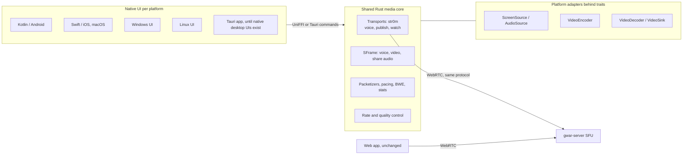

# Native clients and native media (plan)

Status: **plan, not scheduled.** Nothing here has a date. It describes where
the clients are going, which pieces exist, and which pieces a contributor can
build, in what order, and how each one is accepted.

It extends [screen-share.md](screen-share.md). That design ships screen
sharing through the server's SFU from browsers and the Tauri desktop app's
webview. This plan covers what comes after: native capture, encoding and
watching in Rust and per-platform adapters, on every platform. Where it
changes an earlier plan, it says so ([Changes to earlier plans](#changes-to-earlier-plans)).

Facts about platform APIs link to their source. Anything not confirmed in
official documentation is marked **(to verify)**. The list is collected in
[Items to verify](#items-to-verify).

## Contents

1. [Goal and scope](#1-goal-and-scope)
2. [Architecture target](#2-architecture-target)
3. [Codecs](#3-codecs)
4. [Resolutions and quality](#4-resolutions-and-quality)
5. [Capture per platform](#5-capture-per-platform)
6. [Watching natively](#6-watching-natively)
7. [Shared audio](#7-shared-audio)
8. [Work breakdown](#8-work-breakdown)
9. [Testing strategy](#9-testing-strategy)
10. [Risks and open questions](#10-risks-and-open-questions)

## 1. Goal and scope

### Where we are

| Client | UI | Voice | Screen sharing |
| --- | --- | --- | --- |
| Web (`apps/web`) | React | WebRTC in the browser, SFrame worker | Being built: `getDisplayMedia`, VP9/VP8 ([screen-share.md](screen-share.md)) |
| Desktop (`apps/desktop`, Tauri 2) | the same React UI in the system webview | **native**: `gwar-client` (str0m, cpal, Opus, SFrame in Rust) | macOS 14.6+ and Windows through the webview; none on Linux ([owner decision 1](screen-share.md#owner-decisions)) |
| Android | being built separately (docs on its branch) | | |
| iOS | none | none | none |

A native Android client is being built separately (docs on its branch). It is
not on `main`.

### Goal

Eventually every client is native, desktop included. The web app stays as a
first-class client beside them. For media this means:

- **Native screen sharing on every platform:** macOS, Windows, Linux, Android
  and iOS. Capture, encoding, encryption and sending happen in native code,
  not in a webview.
- **H.264 with hardware encoding** wherever the platform has an encoder, and
  resolutions above today's 1080p cap (1440p, 2160p) where the network and
  the server allow it.
- **Screen plus audio sharing.** The share carries what the computer or phone
  plays.
- **Gwar's own audio is never in the share.** Other people's voices, played by
  Gwar, must not be captured. Otherwise viewers hear themselves, or the call,
  echoed back.
- **Native watching:** hardware decoding and rendering of shares, and playback
  of shared audio mixed with voice.

### Non-goals

- Changing the wire protocol or the SFU's model. Native clients are ordinary
  WebRTC peers on the same `screen.publish.offer` and `screen.watch.offer`
  transports ([§2](#wire-compatibility)).
- Transcoding on the server. The SFU forwards; it never decodes or re-encodes
  ([screen-share.md §3](screen-share.md#3-the-sfu)).
- Camera video, recording, remote control and peer-to-peer. They stay where
  [screen-share.md](screen-share.md#goals-and-non-goals) put them.
  Peer-to-peer is still that document's phase 3.
- Game capture by injection (hooking a game's swap chain, as OBS's game
  capture does). Gwar uses only the operating system's capture APIs.
- Dropping the web app or the Tauri desktop app before native clients replace
  them. The Tauri app stays the desktop client until a native desktop UI
  exists, and it is the first consumer of the native media engine
  ([B10](#track-b-shared-rust-media-core)).
- Choosing the native desktop UI toolkit. That is an
  [open owner decision](#owner-decisions-needed).

## 2. Architecture target



### One media core

Today `crates/gwar-client` holds the native voice engine: str0m in RTP mode,
cpal, Opus, the jitter buffer, echo cancellation and RFC 9605 SFrame
([voice-native-5d.md](voice-native-5d.md)). Native media grows from the same
place. The target is one engine for voice and screen:

- **Transport.** str0m 0.24, as voice. Screen transports use str0m's
  **frame mode**: str0m packetizes outgoing frames and depacketizes incoming
  ones (VP8, VP9, H.264, H.265 and AV1 packetizers are in
  `str0m-0.24.1/src/packet/`). Each share is its own `Rtc`, exactly as a
  browser's is ([screen-share.md, Transports](screen-share.md#transports)).
- **SFrame.** The key state that 5d ported to Rust
  (`crates/gwar-client/src/voice/sframe.rs`) is reused per media kind, with
  the video frame layouts from
  [screen-share.md, Frame layout](screen-share.md#frame-layout) and the H.264
  layout from [§3](#encryption-nal-aware-sframe).
- **Pacing and bandwidth.** str0m's send-side estimate (TWCC) on the publish
  transport drives the encoder's target bitrate. str0m's pacer sends.
- **Stats.** One counters type per transport, exported like
  `voice_crypto_counters`, and readable from every UI.
- **Threads.** The voice pipeline keeps its dedicated real-time thread
  ([latency.md, Pipeline scheduling](latency.md#pipeline-scheduling)) and the
  voice RTC task stays separate. Screen transports, encoders and decoders run
  on their own threads and never block either.

The proposed layout is a new crate, `crates/gwar-media`, for the
platform-neutral parts (traits, frame types, SFrame layouts, transports, rate
control), and platform adapters as modules or crates behind `cfg`:

| Adapter set | Platforms | Contents |
| --- | --- | --- |
| `apple` | macOS, iOS | ScreenCaptureKit, Core Audio taps, VideoToolbox |
| `windows` | Windows | Windows.Graphics.Capture, WASAPI, Media Foundation |
| `linux` | Linux | xdg-desktop-portal, PipeWire, VA-API |
| `android` | Android | the Rust side of MediaCodec and MediaProjection hand-off |
| `soft` | libvpx: all; OpenH264: macOS, Windows, Linux | libvpx (software VP9/VP8 encode and decode); Cisco's OpenH264 binary (software H.264), never on iOS or Android ([Software fallbacks](#software-fallbacks)) |

Voice moves into `gwar-media` only if that makes sharing code simpler. Moving
it is not a goal, and the voice engine's latency gates apply to any change
that touches it.

### Adapter traits

The traits are sketches. Their final form is work item
[B1](#track-b-shared-rust-media-core).

```rust
/// A screen, window or app picked by the user through the platform picker.
pub trait ScreenSource: Send {
    fn caps(&self) -> SourceCaps;                 // max size, fps, cursor modes, HDR
    fn start(&mut self, cfg: CaptureConfig, sink: Box<dyn FrameSink>) -> Result<()>;
    fn reconfigure(&mut self, cfg: CaptureConfig) -> Result<()>; // size and fps caps
    fn stop(&mut self);
}

/// System or application audio, with Gwar's own output excluded.
pub trait AudioSource: Send {
    fn exclusion(&self) -> Exclusion;             // OwnProcessExcluded | NotExcluded
    fn start(&mut self, sink: Box<dyn AudioSink>) -> Result<()>; // 48 kHz stereo f32
    fn stop(&mut self);
}

pub trait VideoEncoder: Send {
    fn caps(&self) -> EncoderCaps;                // codec, profiles, max size, hardware
    fn encode(&mut self, frame: RawFrame, keyframe: bool) -> Result<()>;
    fn set_rate(&mut self, bitrate_bps: u32, max_fps: u32);
    // Output: EncodedFrame { codec, data (Annex B for H.264), keyframe, capture_ts }
}

pub trait VideoDecoder: Send {
    fn decode(&mut self, frame: EncodedFrame) -> Result<()>; // output to a VideoSink
    fn reset(&mut self);
}

pub trait VideoSink: Send {
    fn present(&mut self, frame: DecodedFrame);  // GPU surface where possible
}
```

`RawFrame` and `DecodedFrame` carry a platform GPU surface (an `IOSurface`, a
D3D11 texture, a dmabuf, an Android `Surface`) when the adapter can stay on
the GPU, and CPU planes (NV12, I420, BGRA) otherwise. The zero-copy path is
the normal one on every platform with a hardware encoder.

Two integration styles are allowed:

- **Rust-owned adapters** (desktop). Rust calls the OS APIs through `objc2`,
  `windows`, `ashpd` and `pipewire` crates, and owns the whole pipeline.
- **Platform-owned capture and encode** (mobile). On Android, MediaProjection
  renders into a MediaCodec input `Surface` with no copy. On iOS, the
  capture callback hands sample buffers to VideoToolbox. The platform code
  pushes `EncodedFrame`s into Rust through an `EncodedVideoSink` interface.
  Rust still owns SFrame, packetization, transport and rate control, and
  tells the platform encoder its target bitrate and when to make a keyframe.

### The UniFFI boundary

Native UIs call Rust through [UniFFI](https://mozilla.github.io/uniffi-rs/),
which generates Kotlin and Swift bindings. Shared logic stays in Rust. The
boundary is coarse:

- objects: `MediaSession` (per connection), `ShareHandle`, `WatchHandle`;
- calls: start or stop a share with a preset and a source, watch or unwatch
  a share, set its volume, read stats;
- callback interfaces: share and watch state, stats, errors, and, for
  platform-owned encoders, `EncodedVideoSink` (frames in) and
  `EncoderControl` (bitrate and keyframe requests out).

Per-frame data does not cross the boundary as copies where it can be avoided.
GPU surfaces and native windows cross as opaque handles through a thin
platform shim (JNI for an Android `Surface`, a pointer for a `CALayer`),
because UniFFI has no type for them **(to verify: current UniFFI support for
foreign handles)**. Windows and Linux bindings depend on the desktop UI
decision ([Owner decisions needed](#owner-decisions-needed)). A Rust UI on
Linux would need no bindings at all.

The Tauri app is the exception: it reaches the same core through Tauri
commands, like voice today. It keeps the command-surface rules of
[architecture.md, Native command surface](architecture.md#native-command-surface).

### The web client stays first-class

- The browser keeps capturing with `getDisplayMedia` and sending from the web
  layer, as designed in [screen-share.md](screen-share.md).
- It needs **no server change** for native peers. A native sharer is just
  another publisher; a native viewer is just another watch transport.
- The only web changes are on the receiving side: decoding H.264 shares from
  native sharers, and handling a codec switch
  ([Track E](#track-e-web-side-changes)).

### Wire compatibility

- Same protocol: `screen.start`, `screen.publish.offer`,
  `screen.watch.offer`, `screen.watch`, `screen.keyframe` and the events in
  [screen-share.md, Requests](screen-share.md#requests-gwar4). A native
  client sends the same SDP shapes a browser sends: one `sendonly` video
  m-line with RTX per share, four `recvonly` video m-lines per watch
  transport, and the audio m-lines of
  [Shared audio](screen-share.md#shared-audio-phase-2) once they exist.
- Same SFU, same admission, same limits, same keyframe throttle. The SFU
  cannot tell a native peer from a browser, and must not need to.
- Same keys: `MLS-Exporter("gwar screen v1", …)` for video and
  `"gwar screen audio v1"` for share audio, with the same frame layouts.
- The protocol additions this plan needs (H.264 and codec switching, layer
  declarations, publisher replacement, resolution tiers, simulcast) are
  additions every client gets, the web app included. They are in
  [Track A](#track-a-sfu-and-protocol).

## 3. Codecs

### What each side does today

| | VP9 | VP8 | H.264 | AV1 | H.265 |
| --- | --- | --- | --- | --- | --- |
| Web sharers (phase 1) | preferred | fallback | not sent | no | no |
| SFU (PR 3a, #136) | forwarded | forwarded | **not negotiated** | no | no |
| str0m 0.24.1 | packetizer, depacketizer | yes | yes (STAP-A out, FU-A) | yes | yes |
| Browsers decode | all | all | all, see below | most | some |
| Hardware encoders | some Intel/NVIDIA, none on Apple | rare | **everywhere** | newest GPUs | Apple, recent GPUs |

Sources: [screen-share.md, Support](screen-share.md#support), the str0m
source.

### H.264 plan

H.264 is the codec with hardware encoders on every target platform. It is the
default for native sharers once the SFU and the web viewers handle it.

#### SFU payload handling (A1, A2)

The SFU reads only enough of each RTP payload to find frame and keyframe
starts, as it does for VP9 and VP8 (`describe` in
`media/screen/ingress.rs`, PR 3a). For H.264
([RFC 6184](https://www.rfc-editor.org/rfc/rfc6184)):

- The NAL unit type is the low 5 bits of the first payload byte.
  - 1–23: a single NAL unit packet.
  - 24 (STAP-A): aggregated NAL units, each with a 16-bit size. The SFU walks
    them, bounded by the payload length.
  - 28 (FU-A): a fragment. The FU header's S bit marks the first fragment, and
    its type field is the fragmented NAL's type.
  - Other types (STAP-B, MTAP, FU-B) are refused: they are not allowed in
    `packetization-mode=1`.
- **Frame start:** the first packet of a new RTP timestamp, as for VP8/VP9.
- **Publisher contract:** every IDR access unit is in the canonical form of
  [§3, Encryption](#encryption-nal-aware-sframe): it starts with one SPS
  followed by one PPS, then optional SEI, then the IDR slices. str0m's
  packetizer produces this order from canonical input: it holds SPS and PPS
  and sends them as one STAP-A, SPS first, before the next NAL
  (`str0m-0.24.1/src/packet/h264.rs`). Each encoder adapter is responsible
  for the in-band parameter sets; no platform encoder is assumed to provide
  them:
  - VideoToolbox emits length-prefixed (AVCC) sample buffers and keeps SPS
    and PPS in the buffer's format description, not in the samples. The
    Apple adapter (C1, C9) reads them with
    [`CMVideoFormatDescriptionGetH264ParameterSetAtIndex`](https://developer.apple.com/documentation/coremedia/cmvideoformatdescriptiongeth264parametersetatindex(_:parametersetindex:parametersetpointerout:parametersetsizeout:parametersetcountout:nalunitheaderlengthout:))
    and builds the Annex B access unit, SPS and PPS first on every keyframe,
    as upstream WebRTC's `H264CMSampleBufferToAnnexBBuffer` does
    ([`nalu_rewriter.cc`](https://webrtc.googlesource.com/src/+/refs/heads/main/sdk/objc/components/video_codec/nalu_rewriter.cc)).
  - MediaCodec has `KEY_PREPEND_HEADER_TO_SYNC_FRAMES` (API 29); C7 checks
    the output rather than trusting the key.
  - Media Foundation MFTs, VA-API, NVENC and OpenH264 are checked by their
    items (C3, C5, B3) the same way.
  - Chrome's and Safari's behaviour is checked by E1 **(to verify)**.

  Every encoder adapter passes a late-join test with real encoder output
  ([Track C acceptance](#track-c-per-platform-capture-and-encode)). The SFU
  never caches or injects parameter sets.
- **Keyframe candidate:** a packet whose first NAL (single, or first STAP-A
  unit) is an SPS (7). It may open a segment only once confirmed.
- **Confirmation by the IDR slice.** The SFU does not forward a candidate's
  packets to waiting slots until the packet carrying the start of the first
  IDR slice (5) of the same RTP timestamp has arrived (a single NAL, a STAP-A
  unit, or an FU-A with S = 1). Until then, while any slot of the share
  waits, the packets of the newest RTP timestamp are held in a **bounded
  prefix buffer** per share, from the first one that arrives:
  - at most 8 packets and 16 KB, all of one RTP timestamp, ordered by
    sequence number whatever their arrival order;
  - **confirmed** when the buffer holds a gap-free run of sequence numbers
    from the SPS packet to the IDR slice start, containing a PPS before the
    IDR, with no non-IDR slice (1) in between. The held packets are then
    released in sequence order, the SPS packet marked as the keyframe start
    (so `Segment::map`'s base is the SPS packet), followed by the IDR packet
    and the rest of the access unit as it arrives;
  - **failed** when the access unit ends first (marker bit or a newer
    timestamp), when the bound is exceeded, or when a non-IDR slice appears.
    The held packets are dropped for waiting slots and one throttled PLI is
    sent ([Keyframes](screen-share.md#keyframes)).

  Only waiting slots and a share whose ingress is blocked (its first
  keyframe, or after an overrun) use the buffer. Slots already inside a
  segment get every packet on arrival as today, so the buffer adds no
  latency outside joins and recoveries, and a join waits only for the
  packets between the SPS and the IDR start, which the publisher sends
  back to back. Held packets count against the buckets and frame bounds on
  arrival, as now.
- **Edge cases**, each a test in A2:
  - *missing parameter sets:* an IDR slice start with no confirmed candidate
    (SPS or PPS lost, or never sent) opens nothing, and one throttled PLI
    follows;
  - *reordered parameter sets:* an IDR start that arrives before the SPS
    packet is held; the candidate is confirmed when the SPS packet arrives,
    if the bound is not exceeded;
  - *marker before repair:* when the access unit's marker packet arrives
    while the prefix still has a gap (a lost PPS packet awaiting RTX), the
    candidate fails. The later repair is forwarded only to slots already in
    a segment, as any repair is.

  Provisional forwarding (opening the segment at the SPS and rolling back
  if no IDR follows) was rejected. PR 3a's ingress (`Ingress::admit`) and
  `Segment::map` act on each packet as it arrives, so a rollback cannot
  recall packets a viewer already has. The viewer would then get a frame
  with parameter sets and no slice, which fails to open in encrypted
  channels and wastes its keyframe budget.
- Malformed payloads (a STAP-A unit longer than the packet, an FU-A with both
  S and E set, an empty NAL) are dropped and counted, like a truncated VP9
  descriptor.

#### Negotiation (A2)

- `packetization-mode=1` only. Mode 0 (one NAL per packet) cannot carry a
  1080p slice in one MTU and is not offered.
- **Profiles:** Constrained Baseline (`42e0xx`) is accepted everywhere.
  Constrained High (`640cxx`), or High (`6400xx`) without B-frames, is sent
  to a viewer only if it offered that profile (Apple's `low-latency`
  configuration produces High, see
  [Hardware encoders](#hardware-encoders-per-platform)). Main, and any
  profile with B-frames, are not used: B-frames add a frame of latency.
- **Levels are enforced.** The answers set `level-asymmetry-allowed=1`. Per
  [RFC 6184 §8.2.2](https://www.rfc-editor.org/rfc/rfc6184#section-8.2.2),
  that lets the two directions use different levels; it does not let a
  sender exceed a receiver: "the level to use in the offerer-to-answerer
  direction MUST be equal to the highest level the answerer supports for
  receiving". A viewer's receive limits are the level of its
  `profile-level-id` (or `max-recv-level`), extended by `max-fs`, `max-mbps`,
  `max-br` and `max-dpb` when present (RFC 6184 §8.1).
  - The SFU records the limits per viewer and payload type, and treats them
    as part of what the viewer decodes. A stream is compatible with a viewer
    only if codec, profile, level and those limits all fit.
  - The SFU knows each stream's profile and level from the sharer's layer
    declaration ([A3](#track-a-sfu-and-protocol)) and checks it against the
    first three bytes after the SPS NAL header (`profile_idc`, constraint
    flags, `level_idc`), which stay clear in every channel. A keyframe whose
    SPS does not match the declaration fails like a keyframe without an IDR.
  - For an incompatible viewer the rule of
    [Codec negotiation](#codec-negotiation-across-mixed-viewers) picks a
    compatible layer, a codec switch, a lower publisher output, or an
    explicit refusal. A viewer is never sent a level above its limits.
  - Browsers often offer level 3.1 (`42e01f`), which covers 1280×720 at 30
    fps but not 1080p. Which levels each browser offers, and whether that
    can be raised, is **(to verify per browser; E1)**. If browsers offer only
    3.1, 1080p H.264 reaches them through a 720p layer or the VP9 fallback.
  - Native viewers offer the level their decoder supports (5.1 for 2160p30).
- **Payload types:** one m-line can carry several codecs. The publish m-line
  offers every codec the sharer can encode (H.264 and VP9/VP8), and the SFU
  maps each viewer's payload type for the codec in flight.

#### Ingress frame bounds

H.264 frames are bounded like VP9 frames: 512 KB,
600 packets and 500 ms per RTP timestamp
([Ingress enforcement](screen-share.md#ingress-enforcement)). Higher
resolutions need tiered bounds ([§4](#sfu-limits-to-raise)).

#### Encryption: NAL-aware SFrame

Spike S3 showed browsers' H.264 packetizers send nothing when the whole frame
is encrypted ([screen-share.md, Spikes](screen-share.md#spikes)). The layout,
already chosen in [screen-share.md §2](screen-share.md#support), is:

- everything up to and including the start of the first slice's header
  stays clear: start codes, SPS, PPS, SEI, the slice NAL header byte, and
  the **slice header bytes up to and including the byte that holds the last
  bit of `pic_parameter_set_id`** (the third `ue(v)` field, after
  `first_mb_in_slice` and `slice_type`). It is RFC 9605 *metadata*, so it is
  authenticated (AAD = `header || clear`);
- the rest, `SFrameHeader || AEAD(remaining slice data and later NALs)`, is
  **start-code escaped** and then ends with a **trailer** (below), so no
  packetizer splits or trims the ciphertext. The receiver checks and removes
  the trailer and unescapes before opening.
- Without escaping, about one frame in 2^24 ciphertext bytes contains a
  start code and is lost. Spike S3's unescaped variant worked only by luck.

**Why the slice header prefix stays clear.** WebRTC receivers (Chromium, and
WebKit, which uses the same libwebrtc) parse the first slice of each packet
*before* the receive transform runs. `ParseSliceHeader`
([`pps_parser.cc`](https://github.com/webrtc-mirror/webrtc/blob/main/common_video/h264/pps_parser.cc))
reads `first_mb_in_slice`, `slice_type` and `pic_parameter_set_id`; the
depacketizer
([`video_rtp_depacketizer_h264.cc`](https://github.com/webrtc-mirror/webrtc/blob/main/modules/rtp_rtcp/source/video_rtp_depacketizer_h264.cc))
uses `first_mb_in_slice == 0` to mark the first packet of a frame and drops
a single-NAL or STAP-A slice whose header does not parse. The SPS/PPS
tracker
([`h264_sps_pps_tracker.cc`](https://github.com/webrtc-mirror/webrtc/blob/main/modules/video_coding/h264_sps_pps_tracker.cc))
then looks up that PPS id for the first packet of an IDR and answers
`kRequestKeyframe` if it has not seen that PPS, and the receiver drops the
packet
([`rtp_video_stream_receiver2.cc`](https://github.com/webrtc-mirror/webrtc/blob/main/video/rtp_video_stream_receiver2.cc));
the frame transformer only sees assembled frames. If the SFrame header
followed the NAL header byte, those fields would be read from it: a 6-byte
header `c0 01 00 00 00 00` (KID 1 << 32, counter 0) reads as
`first_mb_in_slice = 0`, `slice_type = 0` and PPS id 8191. The packet would
be dropped before the opener runs, and no canonicalization after
depacketization could recover it. Keeping those bits in the clear (at most
about 8 bytes at 2160p, plus emulation prevention bytes) and authenticating
them avoids this. The bits after `pic_parameter_set_id` in the last clear
byte stay clear too.

**Escaping and trailer, unambiguous.**

- Escaping runs over the bytes after the clear part, continuing the zero
  count from the clear part's last bytes: wherever two zero bytes are
  followed by a byte `00`, `01`, `02` or `03`, an emulation prevention byte
  `03` is inserted before it, as in H.264.
- The escaped bytes are always followed by one **trailer byte `80`**, which
  is also H.264's `rbsp_trailing_bits`. Because `80` is above `03`, the
  escaper never has to look past the payload's end, and the NAL never ends
  in `00`.
- The receiver requires the last byte to be `80` and removes it, then
  removes each `03` that follows two zero bytes. It **rejects** any input
  the escaper cannot produce: a missing trailer, `00 00` followed by `00`,
  `01` or `02`, or `00 00 03` followed by anything but `00`–`03` (the
  trailer included). Escaping is then a bijection between ciphertexts and
  valid escaped payloads.
- Ciphertext ending `aa 00` is sent as `aa 00 80`; ciphertext ending
  `aa 00 03` as `aa 00 03 80`; ending `00 00` as `00 00 80`; ending
  `00 00 03` as `00 00 03 03 80`. These four are explicit vectors in B2.

**The clear part is authenticated in canonical form.** The packetizer and
depacketizer rewrite the clear bytes. str0m 0.24.1
(`str0m-0.24.1/src/packet/h264.rs`):

- drops AUD (9) and filler (12) NALs when packetizing;
- treats every zero byte before `00 00 01` as part of the start code, so a
  NAL's trailing zero bytes are lost;
- holds SPS and PPS and sends them as one STAP-A, SPS first, before the next
  NAL, keeping only the latest of each;
- writes a four-byte start code (`00 00 00 01`) before every NAL when
  depacketizing, whatever the sender used.

So an access unit with an AUD, three-byte start codes, or PPS before SPS
cannot authenticate unchanged. The rule:

- **Canonical form:** four-byte start codes; no AUD or filler NALs; no
  trailing zero bytes before a start code; parameter sets only at the start
  of an IDR access unit, as one SPS followed by one PPS; then SEI, then the
  slices.
- **The sealer canonicalizes before encryption.** The clear part and the AAD
  are taken from the canonical bytes, and the canonical bytes are what goes
  to the packetizer.
- **The opener canonicalizes after depacketization**, with the same
  function, before it checks the tag. The decoder gets the opened canonical
  bytes, never the raw depacketized ones, so bytes outside the canonical
  form are neither authenticated nor decoded.
- The function is idempotent, and `canonicalize(depacketize(packetize(c)))`
  equals `c` for every canonical `c`, for str0m and for each browser
  receiver. Whether Chromium's and WebKit's receivers change the clear bytes
  in other ways (WebRTC's SPS/PPS tracker can insert parameter sets before an
  IDR that lacks them) is **(to verify; E2)**; the publisher
  contract above means they never need to.

The exact byte rules (the canonical form, the slice header prefix counted
over the NAL's bytes with its emulation prevention bytes, which NALs are
clear when several slices exist, the escaping and trailer, the bounds) are
written once, with test vectors
shared by Rust and TypeScript, in work item [B2](#track-b-shared-rust-media-core)/[E2](#track-e-web-side-changes).
The same vectors gate both implementations, like
`crates/gwar-client/tests/sframe-interop.json` does for voice. Vectors alone
do not prove the round trip through real packetizers, so B2 and E2 also
require **seal → packetize → SFU → depacketize → open** tests, with input
that has AUDs and with input that has three-byte start codes, and with real
RFC 9605 headers at every KID and CTR width, through str0m and through
Chromium's and WebKit's receive paths. SPS and PPS
stay clear, so the server sees resolution and profile; it already sees
resolution for VP9 ([What the server still sees](screen-share.md#what-the-server-still-sees)).

#### Browser interop

Native H.264 must play in every browser that watches.

| Viewer | H.264 decode | Notes |
| --- | --- | --- |
| Chrome / Edge | yes; hardware where available, FFmpeg otherwise | Chromium builds without proprietary codecs (some Linux distributions) may lack H.264 **(to verify)** |
| Safari / WKWebView | yes (VideoToolbox) | offers `42e01f` and `640c1f` (spike S1) |
| Firefox | yes, through the OpenH264 plugin Firefox downloads, or platform decoders | the plugin may be missing or disabled; High profile support **(to verify)** |
| Desktop app webview | as Safari (macOS) and Chrome (Windows) | Linux webview has no WebRTC |

This is why Constrained Baseline is the default and why a viewer that cannot
decode the share's codec must still be served ([codec negotiation](#codec-negotiation-across-mixed-viewers)).

### Hardware encoders per platform

| Platform | API | Notes |
| --- | --- | --- |
| macOS, iOS | VideoToolbox (`VTCompressionSession`) | two configurations, below; output is AVCC with parameter sets in the format description, converted to Annex B by the adapter ([Publisher contract](#sfu-payload-handling-a1-a2)); takes `IOSurface`-backed pixel buffers from ScreenCaptureKit with no copy |
| Windows | Media Foundation H.264 encoder MFTs | vendor hardware MFTs (NVIDIA NVENC, AMD AMF, Intel Quick Sync) are found with `MFTEnumEx` and `MFT_ENUM_FLAG_HARDWARE`; D3D11 textures in through the DXGI device manager ([Microsoft](https://learn.microsoft.com/en-us/windows/win32/medfound/h-264-video-encoder)); a direct NVENC path only if MFT latency falls short **(to verify)** |
| Linux | VA-API (Intel, AMD), NVENC (NVIDIA) | dmabuf from PipeWire into VA-API without a copy; some distributions build Mesa without H.264 encode for patent reasons **(to verify which)**; Vulkan Video encode is a later option |
| Android | MediaCodec | input `Surface` fed by the projection's virtual display; low-latency and priority keys vary by device **(to verify per vendor)** |

Encoder settings for screen content, all platforms: no B-frames, one slice
per frame unless the encoder needs more, infinite GOP with keyframes only on
request (PLI) or on a resolution change, CBR-like rate control with a short
window, and parameter sets on every IDR.

**Apple encoder configurations.** Apple documents that low-latency rate
control (`kVTVideoEncoderSpecification_EnableLowLatencyRateControl`, macOS
11.3+, iOS 14.5+) supports "Only High profiles. The encoder sets the levels
automatically"
([Apple](https://developer.apple.com/documentation/videotoolbox/kvtvideoencoderspecification_enablelowlatencyratecontrol)).
It cannot produce the Constrained Baseline default, so the Apple adapter has
two configurations. **Neither lets Gwar set the level.** VideoToolbox's
only Constrained Baseline key is `kVTProfileLevel_H264_ConstrainedBaseline_AutoLevel`,
and FFmpeg's VideoToolbox encoder warns that with it "Level is
auto-selected ... The output may be encoded with a different level"
([`videotoolboxenc.c`](https://github.com/FFmpeg/FFmpeg/blob/master/libavcodec/videotoolboxenc.c)).
So both configurations advertise what they actually produce:

| Configuration | Settings | Advertised in the layer declaration |
| --- | --- | --- |
| `compat` (default) | `kVTProfileLevel_H264_ConstrainedBaseline_AutoLevel`; `RealTime`; no frame reordering; standard rate control (average bitrate plus data rate limits); size and frame rate chosen to fit the share's viewers, which is the only influence on the level | profile and level read from the first SPS the session produces |
| `low-latency` | `EnableLowLatencyRateControl`; High profile; level chosen by the encoder | profile and level read from the first SPS the session produces |

- **The declaration follows the SPS.** The adapter holds the session's
  first keyframe until it has read the SPS, sends the layer declaration
  (A3) with that profile and level, then sends the keyframe. A new session
  (reconfiguration, size change) repeats this before its first keyframe. The
  declaration therefore always matches the SPS, and A3's check never
  rejects a correct encoder's keyframes.
- **If the produced level does not fit a viewer**, nothing is forced on the
  wire: that viewer is handled by rule 4 of
  [Codec negotiation](#codec-negotiation-across-mixed-viewers) (another
  layer, a codec switch, a lower output, or a refusal). For a lower output
  the adapter opens a session at a smaller size or frame rate and again
  declares what its SPS shows.
- Whether a fixed-level plain Baseline key (`kVTProfileLevel_H264_Baseline_3_1`
  and similar) produces an SPS with `constraint_set1_flag`, which would make
  it Constrained Baseline at a chosen level, is **(to verify; C1)**. If it
  does, `compat` may use it; the declaration still comes from the SPS.
- `compat` is used whenever any viewer of the layer accepts only
  Constrained Baseline, and until the first SPS of a `low-latency` session
  shows a profile and level every viewer of the layer accepts.
- Whether `low-latency` emits Constrained High (`640c`) or plain High
  (`6400`) is **(to verify; C1)**. Plain High is used only for viewers that
  offered it.
- Switching configuration is a new encoder session and a keyframe on the
  same m-line, like a codec switch.

### Software fallbacks

Software encoding is the fallback when no hardware encoder exists, and the
reference for tests and CI.

- **H.264: OpenH264.** Cisco pays the MPEG LA royalties only for the binary
  module that Cisco distributes; "if a team uses the source code, the team is
  responsible for paying all applicable license fees", and products using the
  Cisco module "must download it at the time the product or project is
  installed" ([OpenH264 FAQ](https://www.openh264.org/faq.html)). The
  `openh264` Rust crate builds from source by default and can load Cisco's
  binary instead with its `libloading` feature
  ([openh264-rs](https://github.com/ralfbiedert/openh264-rs)). So:
  - release builds **download Cisco's binary** on first use and verify it,
    and never bundle a source-built OpenH264;
  - source builds are for tests and CI only;
  - whether downloading at first use rather than at install meets Cisco's
    terms is **(to verify)** and an [owner decision](#owner-decisions-needed).
- **Conditions of Cisco's binary.** Its patent licence applies only if
  ([BINARY_LICENSE.txt](https://www.openh264.org/BINARY_LICENSE.txt)):
  - the binary is downloaded separately to the user's device, not combined
    with Gwar before the download;
  - "the end user must have the ability to control (e.g., to enable,
    disable, or re-enable) the use of the Cisco-provided binary";
  - where that control is, Gwar displays "OpenH264 Video Codec provided by
    Cisco Systems, Inc.";
  - the licence text and that last condition are reproduced where Gwar
    presents licensing information.

  B3 builds the setting, the attribution at it, and the notices.
- **Platforms.** The Cisco binary is used only on macOS, Windows and Linux:
  - **iOS:** never. The OpenH264 FAQ leaves iOS out because "iOS does not
    allow for applications to fetch and install modules from the Internet"
    ([FAQ](https://www.openh264.org/faq.html)). iOS uses VideoToolbox for
    H.264 encode and decode, which every supported device has.
  - **Android:** never. Google Play's Device and Network Abuse policy says
    "an app may not download executable code (such as dex, JAR, .so files)
    from a source other than Google Play"
    ([Google](https://support.google.com/googleplay/android-developer/answer/9888379)).
    Android uses MediaCodec for H.264, and libvpx where MediaCodec lacks
    VP9 or VP8.
- **VP9 and VP8: libvpx** (BSD), for software encode and decode. VP9 is the
  fallback codec of the mixed-viewer rule below, and every web sharer sends
  VP9 or VP8, so native viewers must decode both anyway.
- **FFmpeg is not used.** Its licensing (LGPL or GPL by configuration) and its
  patent exposure need a review the OS APIs and libvpx do not
  ([screen-share.md](screen-share.md#why-not-native-capture-now) noted the
  same).

### Later: AV1 and H.265

- **AV1** encodes screen content well (spike S3: 2.3 ms per 720p frame in
  Chromium), but hardware encoders are only on the newest GPUs, and the SFU
  would need the Dependency Descriptor extension for layers. Its SFrame needs
  an OBU-aware layout; spike S3 showed whole-frame encryption sends nothing.
- **H.265** has hardware encoders on Apple and recent GPUs, but Firefox does
  not decode it and Chrome only with hardware
  ([Support](screen-share.md#support)).
- Neither is planned. Each would be one more `describe` and one more SFrame
  layout, behind the same negotiation rules.

### Codec negotiation across mixed viewers

The SFU forwards and never transcodes, so every viewer must decode what the
sharer sends. The rule ([A3](#track-a-sfu-and-protocol)):

1. **Viewers declare what they decode.** A watch offer's m-lines list the
   codecs the viewer can receive, and for H.264 the profiles, levels and
   limits of [Negotiation](#negotiation-a2). The SFU records the set per
   watch transport. Today's browsers all list VP9 and VP8.
2. **Sharers declare what they encode.** The publish m-line lists every codec
   the sharer can send, preferred first. A native sharer offers
   `[H.264, VP9, VP8]` when it has a hardware H.264 encoder, `[VP9, VP8,
   H.264]` otherwise. Web sharers keep today's `[VP9, VP8]`. The sharer also
   declares each layer it sends: codec, profile and level, resolution and
   frame rate (the layer declaration, A3).
3. **The sharer starts with its preferred codec.** No negotiation round
   happens before the first frame.
4. **A viewer that cannot decode what is sent is not silently refused.** A
   layer is *compatible* with a viewer when its codec, profile, level and
   the limits of rule 1 all fit. For a viewer with no compatible layer the
   SFU assigns a slot that waits, then takes the first of these that
   applies:
   1. another layer of the share that is compatible (simulcast, A5);
   2. a codec switch: `screen.codec {share, codec}`, a new event to the
      sharer, for the best codec in the intersection of what the sharer
      encodes and what every current viewer of the share decodes;
   3. a lower output: `screen.codec` with the limits the sharer must stay
      within (a lower level, size or frame rate), when the preset allows it
      (the sharer's rate controller, B6, applies it; Text never trades
      resolution, so it skips this step);
   4. an explicit refusal (rule 8).
5. **The sharer switches at a keyframe**, without a new SDP: a payload type
   change on the same m-line, or a new encoder configuration on the same
   payload type. Native publishers always switch in place. Browsers switch
   in place where they can, otherwise through `screen.publish.replace`
   ([E3](#track-e-web-side-changes), [A3](#track-a-sfu-and-protocol)), which
   keeps the share and its viewers. Each slot's segment starts at the first
   keyframe of a layer compatible with its viewer, using the existing
   wait-for-keyframe rule.
6. **Switching back** to the preferred codec happens when the last viewer
   that needed the fallback leaves, after a 30 s hold so a viewer flapping in
   and out cannot make the sharer flap.
7. **The fallback may lower quality.** A sharer that switches from hardware
   H.264 to software VP9 also lowers the resolution tier to what its CPU can
   encode ([§4](#cpu-and-gpu-budgets)).
8. **If nothing fits** (a viewer that decodes nothing the sharer encodes, or
   whose limits the sharer cannot meet), the watch fails with
   `screen.stopped {reason: "codec"}` and the UI says the viewer's browser
   cannot play this share. This is not expected with VP8 in every list, but
   must be handled.

An alternative is to refuse viewers that cannot decode H.264 and never
switch. It is simpler, and it locks out Chromium builds without H.264 and
Firefox without its plugin. The choice is an
[owner decision](#owner-decisions-needed); this plan recommends switching.

## 4. Resolutions and quality

### Presets beyond 1080p

Today's presets cap at 1080p ([Presets](screen-share.md#presets)). This plan
adds **resolution tiers** to the existing presets instead of new preset
names. A tier is the resolution cap; the preset still decides frame rate,
content hint and how to degrade.

Starting points for H.264 hardware encoding. They are to be measured
([F3](#track-f-measurements-and-qa)) before any default changes.

| Preset | 1080p (today) | 1440p | 2160p |
| --- | --- | --- | --- |
| Text (15 fps, keep resolution) | 2.5 Mbps | 3.5 Mbps | 6 Mbps |
| Smooth (30 fps) | 4 Mbps | 7 Mbps | 12 Mbps |
| Game (60 fps, keep frame rate) | 8 Mbps | 14 Mbps | 2160p30 only: 20 Mbps |

- 2160p60 is not planned: 30 Mbps and more per viewer, and few encoders do
  it at low latency.
- **Text at 1440p and 2160p fits today's 8 Mbps per-share cap.** That is the
  case that benefits most (code and documents on high-DPI screens). Smooth
  1440p fits too. Game 1440p and anything at 2160p beyond Text need a higher
  cap.
- The per-share cap and the 300 Mbps server budget are
  [owner decisions](screen-share.md#owner-decisions) (decision 4). This plan
  **does not change the defaults.** Tiers above what the server's cap allows
  are not offered. Raising the defaults is an
  [open owner decision](#owner-decisions-needed).
- VP9 needs roughly the bitrates above at equal quality **(to verify; F3)**;
  its software encoder is the limit at 1440p60.

### SFU limits to raise

The SFU's per-share limits were sized for 1080p
([Admission and resource limits](screen-share.md#admission-and-resource-limits)).
Higher tiers need them scaled per share, from the share's tier and cap
([A4](#track-a-sfu-and-protocol)). Proposed values, to be confirmed by F3:

| Limit | Today | 1440p tier | 2160p tier |
| --- | --- | --- | --- |
| Frame bytes per RTP timestamp | 512 KB | 1 MiB | 2 MiB |
| Frame packets | 600 | 1,100 | 2,000 |
| Byte bucket burst | 512 KB | 1 MiB | 2 MiB |
| Packet rate | 2,000/s | `max(2,000, 1.25 × cap ÷ 9,200 bits)` | same formula |
| Transport meter | 2,500 packets/s, 1.5 × cap | scaled with the packet rate | same |
| RTX cache per stream | 1,024 packets | ≥ 2 × the frame packet bound | same |
| Encrypted frame bound | 2 MiB | 2 MiB | 3 MiB (escaping can grow ciphertext) |

- The frame span bound (500 ms) and the three-overruns rule stay.
- The RTX cache must hold a whole keyframe, or the first packets of a large
  keyframe cannot be repaired.
- **The 400 ms original-packet deadline does not scale.** A keyframe must
  reach a viewer within 400 ms at `0.8 × estimate`
  ([Queues and repairs](screen-share.md#queues-and-repairs)). A 1 MiB
  keyframe needs an estimate of about 26 Mbps, a 2 MiB one about 52 Mbps.
  Most viewers cannot watch a single-layer 2160p share. **So simulcast comes
  before 2160p is offered for anything but Text** ([next section](#simulcast-or-svc)).

### Simulcast or SVC

A single-layer share pauses viewers whose link cannot carry it
([Bandwidth allocation per viewer](screen-share.md#bandwidth-allocation-per-viewer)).
Layers let them watch at a lower quality instead.

| Option | Who sends it | SFU work | Fit |
| --- | --- | --- | --- |
| VP9 temporal layers (`L1T3`) | Chromium | drop by temporal id from the clear descriptor | screen-share PR 8; lowers fps only |
| VP9 SVC (`L2T3`, `L3T3_KEY`) | Chromium | spatial and temporal dropping from the descriptor | optional; no Firefox or Safari senders |
| **H.264 simulcast**, 2 layers | native sharers (two encoder sessions), Safari, Firefox | per-viewer layer choice, switch at keyframes | **the native plan** |
| VP8 simulcast | all browsers | picture id rewriting (`RtpWrite::vp8_patch`) | screen-share PR 13 |

The native plan is two H.264 layers: the share's tier, and a second layer at
720p and at most 30 fps. Notes:

- The publish m-line carries both layers by RID, as browsers do.
- The SFU picks a layer per viewer from the allocation of
  [Bandwidth allocation per viewer](screen-share.md#bandwidth-allocation-per-viewer),
  and switches only at a keyframe of the target layer, with a PLI for that
  layer alone. A layer switch is a new segment in the existing
  stable-sequence model ([Forwarding](screen-share.md#forwarding-stable-sequence-mapping)).
- Reservations charge the layer a viewer gets, not the top layer's cap.
- The sharer's uplink carries both layers, about 25 % more than the top layer
  alone.
- Hardware encoders limit concurrent sessions on some consumer GPUs
  **(to verify per vendor)**. A sharer that cannot open a second session
  sends one layer.
- This extends screen-share PR 13 (simulcast) to H.264 and native senders:
  SFU forwarding is [A5](#track-a-sfu-and-protocol), the native two-layer
  publisher is [B11](#track-b-shared-rust-media-core). Tiers that need
  layers are offered only after a real B11 publisher passes A5's and B11's
  constrained-viewer tests.

### Bandwidth and VM egress cost

Egress equals the forwarded rate per viewer
([Cost on the deployment VM](screen-share.md#cost-on-the-deployment-vm)).

| Share | Per viewer | 1 hour per viewer | Viewer-hours in 10 TB |
| --- | --- | --- | --- |
| Text 2160p | 1–6 Mbps (mostly static) | 0.5–2.7 GB | 3,700+ |
| Smooth 1440p | 4–7 Mbps | 1.8–3.2 GB | about 3,100 |
| Game 1440p60 | 10–14 Mbps | 4.5–6.3 GB | about 1,600 |
| Game 2160p30 | 15–20 Mbps | 6.8–9 GB | about 1,100 |
| 720p30 simulcast layer | 1.5–2.5 Mbps | 0.7–1.1 GB | about 9,000 |

- One 2160p30 share with 25 viewers at the top layer is 500 Mbps, more than
  the whole 300 Mbps budget. Simulcast puts most viewers on the 720p layer.
- The monthly egress counter (PR 3b) and the server budget stay the guards.
- SFU CPU scales with forwarded Mbps (about 0.4 % of an A1 core per Mbps,
  to be re-measured by PR 3b). 200 Mbps is about 0.8 of an A1 core.

### CPU and GPU budgets

Targets for a sharer, measured by [F2](#track-f-measurements-and-qa):

| Path | Target |
| --- | --- |
| Hardware encode, 1080p60 | ≤ 10 % of one CPU core for capture, encode submission, SFrame and packetization; encode ≤ 8 ms per frame |
| Hardware encode, 1440p60 or 2160p30 | ≤ 15 % of one core; encode ≤ 12 ms per frame |
| Software encode | 1080p30 at most; ≤ 1.5 cores |
| Voice | unaffected: the paired voice gate of [F4](#track-f-measurements-and-qa) |

When to downscale (work item [B6](#track-b-shared-rust-media-core)):

- The encoder reports late or dropped frames, or encode time stays above
  80 % of the frame interval for 2 s.
- The capture adapter reports dropped frames.
- The send-side estimate stays below the current tier's need.

Text keeps resolution and lowers frame rate (as `maintain-resolution`). Game
keeps frame rate and lowers resolution, one tier at a time (as
`maintain-framerate`). Recovery waits 10 s of headroom before stepping up,
to avoid oscillation. A hardware encoder's own silicon is separate from the
3D engine, so a game's frame rate should barely change; F2 measures it.

## 5. Capture per platform

Each platform below has two work items: video ([C1–C10](#track-c-per-platform-capture-and-encode))
and audio. The audio rule is the same everywhere: **if Gwar's own output
cannot be excluded, the share has no sound.** A system mix that contains
Gwar's voice playback is never sent. This is the same rule as
[Shared audio](screen-share.md#shared-audio-phase-2) for browsers.

### Summary

| Platform | Video API | Minimum OS (video) | Audio API, excluding Gwar | Minimum OS (audio) | Consent |
| --- | --- | --- | --- | --- | --- |
| macOS | ScreenCaptureKit + `SCContentSharingPicker` | 14 (owner decision 7; ScreenCaptureKit itself 12.3) | `SCStreamConfiguration.excludesCurrentProcessAudio`, or a Core Audio process tap | 13 / 14.2 | picker; Screen Recording (TCC) without it |
| Windows | Windows.Graphics.Capture | 10 1903 (HWND/monitor interop) | WASAPI process loopback, excluding Gwar's process tree | 10 build 20348 (in practice Windows 11) | picker, or none for interop capture |
| Linux | xdg-desktop-portal ScreenCast + PipeWire | portal v4+ for restore tokens | PipeWire: link every application's output except Gwar's to a capture node | PipeWire session | portal dialog; audio has no portal |
| Android | MediaProjection | 10 (API 29) for audio; 14 for single-app sharing | `AudioPlaybackCapture`; Gwar's voice uses `USAGE_VOICE_COMMUNICATION`, never capturable | 10 (API 29) | system dialog every session (14+) |
| iOS | ScreenCaptureKit (iOS 27+), ReplayKit broadcast extension before | 27, or 12 for the extension picker | ScreenCaptureKit audio with `excludesCurrentProcessAudio` (27+); app audio in the extension | 27 / 12 | system picker |
| Web | `getDisplayMedia` | as today | tab audio; `restrictOwnAudio` (Chrome 141+) | browser-specific | browser picker |

### macOS

**Video.**

- [ScreenCaptureKit](https://developer.apple.com/documentation/screencapturekit)
  is available from macOS 12.3. Frames arrive as `CMSampleBuffer`s backed by
  `IOSurface`, which go to VideoToolbox without a copy.
- [`SCContentSharingPicker`](https://developer.apple.com/documentation/screencapturekit/sccontentsharingpicker)
  (macOS 14+) is the system picker, and Apple's recommended way to choose
  content. Gwar uses it. That keeps the macOS 14 minimum of
  [owner decision 7](screen-share.md#owner-decisions), and matches what the
  webview path already uses.
- With the picker, no Screen Recording (TCC) permission prompt should be
  needed, because the picker is the consent **(to verify in a signed build;
  same open question as screen-share PR 1)**. Capturing without the picker
  needs the Screen Recording permission, which the user grants in System
  Settings. macOS 15 and later periodically ask the user to re-confirm apps
  that capture without the picker **(to verify the current cadence)**.
- `SCStreamConfiguration` sets size, frame interval (`minimumFrameInterval`),
  cursor and pixel format. HDR capture (`captureDynamicRange`) needs macOS 15
  ([Apple](https://developer.apple.com/documentation/screencapturekit/scstreamconfiguration/capturedynamicrange)).
- **Keeping Gwar out of the picture.** A display filter can exclude
  applications' windows
  ([`SCContentFilter(display:excludingApplications:exceptingWindows:)`](https://developer.apple.com/documentation/screencapturekit/sccontentfilter/init(display:excludingapplications:exceptingwindows:))).
  Gwar excludes its own windows by default when a whole display is shared,
  so its chat and the stage are not broadcast and there is no hall of
  mirrors. A setting can turn this off. Whether a picker-chosen filter can be
  modified this way is **(to verify)**.

**Audio.**

- `SCStreamConfiguration.capturesAudio` (macOS 13+) adds system audio to the
  stream ([Apple](https://developer.apple.com/documentation/screencapturekit/scstreamconfiguration/capturesaudio)).
- `excludesCurrentProcessAudio` (macOS 13+) leaves out audio from the
  capturing app ([Apple](https://developer.apple.com/documentation/screencapturekit/scstreamconfiguration/excludescurrentprocessaudio)).
  Gwar's native voice plays from the Gwar process through cpal, so it is
  excluded.
- **Caveat:** sounds the Tauri webview plays (notification sounds) come from
  WebKit's helper processes, which may not count as the current process
  **(to verify)**. The native app has no such helpers. Until verified, the
  Tauri app mutes webview sounds while sharing with audio.
- Alternative: a [Core Audio process tap](https://developer.apple.com/documentation/coreaudio/capturing-system-audio-with-core-audio-taps)
  (`AudioHardwareCreateProcessTap`, macOS 14.2+) captures a mix of chosen
  processes, or of all processes except chosen ones. It needs
  `NSAudioCaptureUsageDescription` and its own permission prompt. It is the
  fallback if ScreenCaptureKit audio proves unreliable, and it allows audio
  sharing without video.
- The microphone is separate. Gwar's voice keeps its own microphone path and
  permission. `captureMicrophone` (macOS 15) is not used.

### Windows

**Video.**

- **Windows.Graphics.Capture** is the main path
  ([Microsoft](https://learn.microsoft.com/en-us/windows/apps/develop/media-authoring-processing/screen-capture)).
  Frames are D3D11 textures, which go to a hardware encoder MFT without a
  copy.
  - `GraphicsCapturePicker` is available from Windows 10 1803 (build 17134)
    ([Microsoft](https://learn.microsoft.com/en-us/uwp/api/windows.graphics.capture.graphicscapturepicker)).
  - `IGraphicsCaptureItemInterop::CreateForWindow` and `CreateForMonitor`
    create an item from an `HWND` or `HMONITOR` without the system picker,
    from Windows 10 1903 (build 18362)
    ([Microsoft](https://learn.microsoft.com/en-us/windows/win32/api/windows.graphics.capture.interop/nn-windows-graphics-capture-interop-igraphicscaptureiteminterop)).
    Gwar can then show its own picker with thumbnails, like other desktop
    apps. **Minimum for native sharing: Windows 10 1903.**
  - **The yellow border.** The system draws a border around what is
    captured. `GraphicsCaptureSession.IsBorderRequired = false` removes it
    from Windows 10 build 20348, after the user consents through
    `GraphicsCaptureAccess.RequestAccessAsync(Borderless)`, which needs the
    `graphicsCaptureWithoutBorder` capability in a package manifest
    ([Microsoft](https://learn.microsoft.com/en-us/uwp/api/windows.graphics.capture.graphicscapturesession.isborderrequired)).
    Whether an unpackaged app can declare it is **(to verify)**. Keeping the
    border is acceptable; it is also a privacy indicator.
  - `MinUpdateInterval` caps the capture rate on Windows 11 24H2 (build
    26100) and later
    ([Microsoft](https://learn.microsoft.com/en-us/uwp/api/windows.graphics.capture.graphicscapturesession.minupdateinterval)).
    Before that, Gwar drops surplus frames itself (a 144 Hz screen delivers
    up to 144 frames a second).
  - HDR displays may deliver `R16G16B16A16_FLOAT`; Gwar converts to SDR on
    the GPU before encoding (the same Microsoft page).
- **DXGI Desktop Duplication** (whole monitors only) is a fallback for
  systems where Windows.Graphics.Capture is unsupported
  (`GraphicsCaptureSession.IsSupported()`)
  ([Microsoft](https://learn.microsoft.com/en-us/windows/win32/direct3ddxgi/desktop-dup-api)).
  It is not planned unless F5's checklist finds such systems.
- **Keeping Gwar out of the picture.** `SetWindowDisplayAffinity(hwnd,
  WDA_EXCLUDEFROMCAPTURE)` hides a window from capture from Windows 10 2004
  ([Microsoft](https://learn.microsoft.com/en-us/windows/win32/api/winuser/nf-winuser-setwindowdisplayaffinity)).
  As on macOS, it is the default while sharing a monitor, with a setting to
  turn it off.

**Audio.**

- **WASAPI process loopback**: `ActivateAudioInterfaceAsync` with
  `AUDIOCLIENT_ACTIVATION_TYPE_PROCESS_LOOPBACK` and
  `AUDIOCLIENT_PROCESS_LOOPBACK_PARAMS {TargetProcessId: Gwar's PID,
  ProcessLoopbackMode: PROCESS_LOOPBACK_MODE_EXCLUDE_TARGET_PROCESS_TREE}`
  captures every render stream **except** those of Gwar's process and its
  children ([Microsoft](https://learn.microsoft.com/en-us/windows/win32/api/audioclientactivationparams/ns-audioclientactivationparams-audioclient_process_loopback_params),
  [sample](https://learn.microsoft.com/en-us/samples/microsoft/windows-classic-samples/applicationloopbackaudio-sample/)).
  - The documented minimum is **Windows 10 build 20348**, which on clients
    means Windows 11. Reports say it works on Windows 10 2004 (build 19041)
    and later **(to verify)**.
  - In the Tauri app, WebView2's processes are children of the app, so they
    fall inside the excluded tree **(to verify)**.
- **Fallback:** whole-system loopback (`AUDCLNT_STREAMFLAGS_LOOPBACK` on the
  output device) ([Microsoft](https://learn.microsoft.com/en-us/windows/win32/coreaudio/loopback-recording))
  includes Gwar's own voice. Gwar does **not** offer it by default. Two
  options remain, both behind an explicit setting with a warning:
  - Gwar plays voice to a different output device than the one captured
    (for example headphones on another device);
  - no sound in the share (the default on Windows builds before process
    loopback works).

### Linux

Native capture is where the native path matters most. The Tauri app's
WebKitGTK has no WebRTC, so the Linux desktop app has no sharing today
([Desktop app](screen-share.md#desktop-app-tauri-212-wry-057)). This plan
does not reverse [owner decision 1](screen-share.md#owner-decisions) for
phase 1. It is the "native Linux path" that decision left open.

**Video.**

- The [ScreenCast portal](https://flatpak.github.io/xdg-desktop-portal/docs/doc-org.freedesktop.portal.ScreenCast.html)
  works on Wayland and X11. The user picks monitors or windows (source types
  1 and 2) in the desktop's dialog. `Start()` returns PipeWire streams;
  `OpenPipeWireRemote()` returns a file descriptor through which only those
  streams are visible.
  - Cursor modes: hidden, embedded or metadata (portal version 2+).
  - `persist_mode` and single-use restore tokens (version 4+) let a later
    share skip the dialog when the user allows it.
  - Version 6 deprecates the node id for targeting in favour of
    `pipewire-serial`.
- Frames arrive as dmabufs where the compositor supports it, and go to VA-API
  without a copy; otherwise as shared-memory buffers.
- Crates: `ashpd` (portal) and `pipewire` are mature
  ([Why not native capture now](screen-share.md#why-not-native-capture-now)).
- Encoding: VA-API or NVENC where available; otherwise OpenH264 (Cisco
  binary) or libvpx in software, at 1080p30 at most.

**Audio.**

- The ScreenCast portal has **no audio**. It defines only video source types
  (same page). An audio portal was proposed but has not landed **(to verify
  current status)**.
- Outside a sandbox, Gwar connects to PipeWire directly and can avoid
  capturing itself:
  - Gwar creates a private capture node (a virtual sink or an input stream).
  - It links the output ports of every application playback node
    (`media.class = Stream/Output/Audio`) **except its own** to that node,
    identifying its own nodes by `application.process.id` (and the PipeWire
    client's security PID), and follows nodes as they appear and disappear.
  - The original playback to the speakers is untouched; the links are added
    beside it.
  - [venmic](https://github.com/Vencord/venmic) (MPL-2.0) does this for
    Discord on Linux and is prior art for the approach and its edge cases.
- **Not** the default sink's monitor: that is the whole mix, Gwar included.
- **PulseAudio-only systems** (no PipeWire) get no shared audio. Their
  monitor sources contain Gwar's voice.
- **Flatpak:** the sandbox limits PipeWire access to what portals grant, so
  the per-application approach may not be possible in a Flatpak build
  **(to verify)**. Distribution format is an
  [owner decision](#owner-decisions-needed).

### Android

The Android client is being built separately (docs on its branch). Its media
items here plug into it later.

**Video.**

- [MediaProjection](https://developer.android.com/media/grow/media-projection):
  the app asks with `createScreenCaptureIntent()`, and the user consents in a
  system dialog.
  - **Consent every session from Android 14.** A projection token is
    single-use, and `createVirtualDisplay()` may be called once per
    projection; reuse throws `SecurityException`.
  - **Foreground service** of type `mediaProjection`, with
    `FOREGROUND_SERVICE_MEDIA_PROJECTION` for apps targeting Android 14.
  - **Single-app sharing** (Android 14+) is on by default: the user may share
    one app instead of the screen. Status bar, navigation bar and
    notifications are not in it.
  - Android 15 QPR1+ shows a status bar chip that stops sharing. Sharing also
    stops when the screen locks. The app must register
    `MediaProjection.Callback.onStop()`.
- The virtual display renders into a MediaCodec encoder's input `Surface`. No
  frame touches the CPU. Encoded output buffers go to Rust
  ([platform-owned encoders](#adapter-traits)).

**Audio.**

- [AudioPlaybackCapture](https://developer.android.com/media/platform/av-capture),
  Android 10 (API 29)+, needs `RECORD_AUDIO` and the same MediaProjection
  consent.
- Only players with usage `USAGE_MEDIA`, `USAGE_GAME` or `USAGE_UNKNOWN` can
  be captured; "all other usages CAN NOT be captured"
  ([reference](https://developer.android.com/reference/android/media/AudioPlaybackCaptureConfiguration)).
  Gwar's voice plays with `USAGE_VOICE_COMMUNICATION`, so it is **never
  captured**.
- Apps can opt out (`android:allowAudioPlaybackCapture="false"`,
  `setAllowedCapturePolicy`), and apps targeting Android 9 or lower are not
  capturable unless they opt in. Some games will share no sound; the UI says
  so when the captured audio stays silent.
- Gwar's other sounds (notifications, previews of shared audio) are kept out
  too: Gwar sets `ALLOW_CAPTURE_BY_SYSTEM` on its own players, and the
  capture configuration excludes Gwar's UID (`excludeUid`). Whether
  `excludeUid` combines with `addMatchingUsage` in one configuration is
  **(to verify)**; the capture policy alone is sufficient.

### iOS

**Video and audio, iOS 27 and later.**

- Apple's documentation now lists ScreenCaptureKit on iOS 27 and states that
  it "replaces ReplayKit for screen streaming and mirroring. A broadcast
  extension is no longer necessary"
  ([Apple](https://developer.apple.com/documentation/screencapturekit)). It
  recommends `SCContentSharingPicker`, a background execution mode for
  capturing in the background, and `NSScreenCaptureUsageDescription`.
- `capturesAudio` and `excludesCurrentProcessAudio` are listed for iOS 27 as
  well. If they behave as on macOS, iOS gets system audio without Gwar's
  voice.
- Everything about this path on iOS is new: which content can be captured
  outside the app, which background mode applies, and audio behaviour are
  **(to verify)** on iOS 27 devices before C9 is designed in detail.

**Before iOS 27: ReplayKit broadcast upload extension.**

- A Broadcast Upload Extension with an `RPBroadcastSampleHandler` subclass
  receives `.video`, `.audioApp` and `.audioMic` sample buffers in
  `processSampleBuffer(_:with:)`
  ([Apple](https://developer.apple.com/documentation/replaykit/rpbroadcastsamplehandler/processsamplebuffer(_:with:))).
  The user starts it from `RPSystemBroadcastPickerView` (iOS 12+)
  ([Apple](https://developer.apple.com/documentation/replaykit/rpsystembroadcastpickerview)).
- The extension is a **separate process** with a small memory limit, commonly
  reported as about 50 MB **(to verify)**. So it encodes in hardware
  (VideoToolbox) inside the extension and keeps no frame queue.
- It has no access to the main app's memory. It needs its own share
  transport, so its own connection to the server, or a hand-off of encoded
  frames to the main app through an App Group (shared container and a local
  socket) **(to verify which is allowed and practical)**. The signalling
  (share id, keys) goes through the App Group either way.
- Keys in the extension: in encrypted channels the extension needs the
  screen key for the current epoch. Passing MLS-exported keys to another
  process widens the key's exposure. The safer design keeps SFrame in the
  main app and hands only encoded plaintext frames across, which needs the
  main app to be running. **Design decision for C9.**
- `.audioApp` is the device's app audio. Whether it contains Gwar's own
  voice playback (a VoIP audio session) is **(to verify)**. If it does,
  shares from the extension have no sound.
- `RPScreenRecorder.startCapture` (iOS 11+) captures only Gwar's own app
  ([Apple](https://developer.apple.com/documentation/replaykit/rpscreenrecorder/startcapture(handler:completionhandler:))).
  It is useless for sharing other apps and is not planned.

The minimum iOS version for sharing is an
[owner decision](#owner-decisions-needed): iOS 27+ only (one path), or the
extension as well.

### Web (stays as is)

Unchanged from [screen-share.md](screen-share.md#browsers). For reference,
MDN browser-compat-data at commit
[`d8fae3e`](https://github.com/mdn/browser-compat-data/tree/d8fae3e315612cc015430e40310f827edbf25a0d)
(2026-10-21; `api/MediaDevices.json` and `api/MediaStreamTrack.json`):

| | Chrome | Edge | Firefox | Safari |
| --- | --- | --- | --- | --- |
| `getDisplayMedia` | 72+ | 79+ | 66+ | 13+, iOS 27+ |
| Audio capture | 74+: "On Windows and ChromeOS, the entire system audio can be captured when sharing an entire screen. On Linux and macOS, only the audio of a tab can be captured." | 79+, as Chrome | no | no |
| `systemAudio` option | 105+ (experimental) | 105+ (experimental) | no | no |
| `windowAudio` option | 141+ (`exclude` and `system` only) | 141–142 only: **removed in Edge 143** | no | no |
| `suppressLocalAudioPlayback` | 109+ | 109+ | no | no |
| `restrictOwnAudio` | 141+ (experimental) | 141+ (experimental) | no | no |

Sources: [MDN getDisplayMedia](https://developer.mozilla.org/en-US/docs/Web/API/MediaDevices/getDisplayMedia),
[restrictOwnAudio](https://developer.mozilla.org/en-US/docs/Web/API/MediaTrackConstraints/restrictOwnAudio),
[browser-compat-data](https://github.com/mdn/browser-compat-data) at the
commit above. Edge entries other than `windowAudio` mirror Chrome's data.

`restrictOwnAudio` removes the capturing tab's own audio. The web app plays
voice in that tab, so it works for the web client. It cannot help the desktop
app, whose voice plays natively outside the webview. That is why desktop
shared audio needs native capture.

## 6. Watching natively

A native viewer runs the watch transport in Rust (str0m frame mode, four
slots), opens SFrame, decodes and renders. The web viewer's behaviour is the
reference: minimal jitter buffer, keyframe recovery after key changes, and
the same pause and resume events.

### Decoding

| Platform | Hardware | Software fallback |
| --- | --- | --- |
| macOS | VideoToolbox (`VTDecompressionSession`); H.264 everywhere, VP9 on recent Apple silicon **(to verify per OS version)** | libvpx (VP9, VP8), OpenH264 (Cisco binary) |
| iOS | VideoToolbox, as macOS; H.264 always in VideoToolbox | libvpx (VP9, VP8); no OpenH264 ([Software fallbacks](#software-fallbacks)) |
| Windows | Media Foundation decoder MFTs with D3D11 (DXVA) for H.264 and VP9 | libvpx, OpenH264 (Cisco binary) |
| Linux | VA-API, NVDEC | libvpx, OpenH264 (Cisco binary) |
| Android | MediaCodec, with `KEY_LOW_LATENCY` where supported (API 30+) | libvpx through the NDK; no OpenH264 |

Native viewers must decode VP9 and VP8 (every web sharer's codecs) and H.264.
A decoder error resets the decoder, marks the slot waiting for a keyframe and
sends `screen.keyframe`, as the web receiver does after a decoder reset
([Keyframe recovery](screen-share.md#keyframe-recovery-around-key-changes)).

### Rendering

| Platform | Renderer |
| --- | --- |
| macOS, iOS | `AVSampleBufferDisplayLayer` for decoded pixel buffers, or Metal (`CAMetalLayer`) |
| Windows | a D3D11 swap chain (flip model) in the UI's window |
| Linux | GTK4 dmabuf textures (`GdkDmabufTexture`) or a wgpu surface, depending on the UI toolkit |
| Android | `SurfaceView`; MediaCodec renders straight into its `Surface` |

Rules:

- **Present on the next refresh.** No extra buffering after decode. Frames
  that arrive late are dropped, not queued.
- **Video jitter buffer:** str0m frame mode delivers complete frames. Gwar
  adds the smallest reorder and completion buffer that keeps frames in decode
  order, with a target of zero, like `jitterBufferTarget = 0` on the web.
- **Scaling** happens in the renderer on the GPU, with the share's pixel
  aspect kept. Text shares are drawn at 1:1 pixels when the stage is large
  enough.
- **Multiple shares:** up to four slots decode at once. Only the stage share
  decodes at full rate; thumbnails may decode only keyframes or a reduced
  rate when the decoder is software **(design detail for D-items)**.

### Latency target

The same budget as [Latency budget](screen-share.md#latency-budget): p50
glass-to-glass at most 150 ms over the internet at 1080p30, and at most
100 ms within a region. Native sharing should save time in capture and
encode (no webview throttling, hardware encode at 2–8 ms). Native watching
should save time in the jitter buffer and render. Higher tiers keep the same
target; their larger keyframes only affect joins and recoveries.

### Shared audio playback

- Share audio is decoded (Opus, stereo, 48 kHz) in Rust and mixed into the
  same native output as voice, with a per-share gain and mute, remembered per
  sharer, as on the web ([viewer controls](screen-share.md#shared-audio-phase-2)).
- **The mix feeds the echo canceller's far-end reference.** Today the native
  engine's echo canceller (`sonora`) sees voice playback. Share audio must be
  in that reference too, or the viewer's microphone sends the share back
  into the call.
- Lip sync: share audio and video come with sender reports on one clock
  (the SFU's arrival wallclock); the viewer delays whichever is early, up to
  a bound (initial value from F6, measured per platform in F8).
- Ducking (lowering share audio while someone speaks) is optional and off by
  default.

## 7. Shared audio

On the wire, native shared audio is exactly
[Shared audio (phase 2)](screen-share.md#shared-audio-phase-2): codec,
m-lines, SFU forwarding, lip sync and the `"gwar screen audio v1"` SFrame
label are specified there and not repeated here. Nothing new is needed on
the server once screen-share PR 9 lands. What differs for native clients:

- **Capture** comes from the platform `AudioSource` adapters of
  [§5](#5-capture-per-platform), not from `getDisplayMedia`. Rust resamples
  to 48 kHz stereo and encodes 20 ms Opus frames (B8).
- **Exclusion of Gwar's voice** is done by the capture adapter, not by
  `restrictOwnAudio`. An adapter that cannot exclude it gives no audio.
- **Encryption** reuses the voice SFrame code with the share-audio label.
  Its counter belongs to the native publish endpoint of
  [B7](#track-b-shared-rust-media-core), like the video counter.
- **Echo:** the native engine has the captured signal, so it can feed the
  sharer's echo canceller (next section). The browser design can only
  suggest headphones.

### Echo and the sharer's microphone

Two loops must not form:

1. **Gwar's voice into the share.** Prevented by capture exclusion
   ([§5](#5-capture-per-platform)). Without exclusion, no audio.
2. **Shared audio into the sharer's microphone.** On speakers, the sharer's
   microphone hears the game or video being shared. Viewers then hear it
   twice: through the share and through the sharer's voice.
   - The native engine has the captured share audio, which is close to what
     the speakers play. It feeds that signal into the sharer's echo
     canceller as an extra far-end reference, so the canceller removes it
     from the microphone.
   - The capture tap and the actual speaker output differ by the output
     path's latency. The canceller's delay estimation must cover it
     (F6's harness measures it; F8 per platform).
   - If F8 shows the canceller cannot remove it reliably, the fallback is
     the web design's: suggest headphones, and offer "Mute the shared audio
     for me".
3. Viewers already feed share audio into their canceller ([§6](#shared-audio-playback)).

### Changes to screen-share PR 10

[Screen-share PR 10](screen-share.md#phase-2-quality-and-reach) plans desktop
shared audio as native capture "fed into the webview's share as a track". The
capture adapters (C2, C4) are the same code either way. How their audio
reaches the share is open:

- through the webview, if WebKit and WebView2 can take a native audio source
  as a `MediaStreamTrack` **(to verify; WKWebView has no generic way that we
  know of)**;
- through the native publish transport (B4), as a second m-line beside a
  webview video m-line on a different transport, which the protocol does not
  allow today, or with native video as well.

If the webview route is not practical, desktop shared audio waits for native
publishing (B4 plus C1/C3), and PR 10 becomes items C2, C4 and B8 of this
plan.

## 8. Work breakdown

Each item is meant to be one pull request, merged on its own with CI green,
following the rules in [screen-share.md §7](screen-share.md#7-phases-and-pull-requests).
Sizes are working days for one person:

- **S:** 1–3 days;
- **M:** 4–8 days;
- **L:** 8–15 days.

"Now" means the item can start today on `main`, which has PR 3a (#136). ★
marks a good first contribution: small, testable alone, and not on a
security boundary.

Open an issue before starting an item, so two people do not build the same
thing. Items that touch encryption, keys or the SFU's limits get a review
round of their own, as voice 5c/5d had.

### Track A: SFU and protocol

**A1. H.264 payload parser ★** (S)
- Builds: `describe` for H.264 in `media/screen/ingress.rs`: single NAL,
  STAP-A and FU-A; frame start, keyframe candidate (SPS first), IDR slice
  start, the presence of a PPS, the three SPS profile and level bytes, and
  malformed payloads ([SFU payload handling](#sfu-payload-handling-a1-a2)).
  No negotiation and no confirmation yet.
- Depends on: PR 3a (#136).
- Acceptance: unit vectors for each packet kind, including a STAP-A with SPS
  and PPS, an FU-A IDR start and continuation, a truncated STAP-A, an FU-A
  with S and E set, and reserved types. Parsing never reads past the payload
  (a fuzz test over random bytes).
- Now: yes.

**A2. H.264 on the screen transports** (M)
- Builds: `enable_h264` with `packetization-mode=1` on publish and watch
  `Rtc`s; profile matching (Constrained Baseline, Constrained High, High
  without B-frames); `level-asymmetry-allowed=1` and per-viewer receive limits (level,
  `max-recv-level`, `max-fs`, `max-mbps`, `max-br`, `max-dpb`) recorded per
  payload type ([Negotiation](#negotiation-a2)); per-viewer payload type
  mapping; the bounded prefix buffer and IDR confirmation of
  [SFU payload handling](#sfu-payload-handling-a1-a2), in `Ingress` and in
  the hand-off to `Segment::map`.
- Depends on: A1, PR 3a.
- Acceptance, in `crates/gwar-server/tests/screen.rs` (added by PR 3a) with
  str0m frame-mode clients:
  - an H.264 publisher reaches two viewers, frames byte-identical;
  - a late viewer starts at the SPS packet of an IDR access unit and gets its
    SPS and PPS;
  - an access unit with SPS but no IDR does not open a segment and causes one
    PLI;
  - the edge cases of [SFU payload handling](#sfu-payload-handling-a1-a2):
    an IDR whose SPS/PPS packet was lost; SPS/PPS arriving after the IDR
    start (reordered by the `LATENCY_NET` relay); the marker packet arriving
    before the RTX repair of a lost PPS packet; a prefix over the bound.
    Each opens no segment for a waiting viewer and causes one throttled PLI,
    or, for the reordered case within the bound, opens the segment at the
    SPS packet;
  - a slot already in a segment sees no added delay from the prefix buffer;
  - publisher-side loss is repaired into place, as for VP9;
  - offers with `packetization-mode=0` only, or only unsupported profiles,
    are refused before negotiation.
- Now: after A1.

**A3. Codec capabilities and switching** (M)
- Builds: the rule in [Codec negotiation](#codec-negotiation-across-mixed-viewers):
  per-viewer decodable sets with H.264 profiles, levels and limits from
  watch offers; the sharer's encodable list from the publish offer; the
  **layer declaration** (codec, profile and level, resolution, frame rate per
  layer), sent or updated by the sharer before the first keyframe it
  describes and taken from that keyframe's SPS, never from encoder
  settings, and its check against each keyframe's SPS bytes; compatibility by
  codec, profile, level and limits; `screen.codec {share, codec, limits}` to
  the sharer; slots that start only at a keyframe of a compatible layer; the
  30 s hold before switching back; and `screen.stopped {reason: "codec"}`.
  - **`screen.publish.replace {share, ssrc, rtx_ssrc, sdp}`**: the sharer
    replaces its publish transport without ending the share, for browsers
    that cannot switch codec in place (E3). The share keeps its id,
    announcement, watch link, reservations and every viewer's slot; slots
    wait for the new transport's first keyframe, which opens a new segment
    as after any drop; no `screen.stopped` or `screen.started` is sent. Only
    the share's own sharer may send it, at most once per keyframe throttle
    window, and only after a `screen.codec` request. This changes
    "one per share, never renegotiated" of
    [Requests](screen-share.md#requests-gwar4)
    ([Changes to earlier plans](#changes-to-earlier-plans)).
  - Protocol types in `gwar-proto`, generated TypeScript, client validators.
- Depends on: A2. The owner decision on switching versus refusing.
- Acceptance:
  - an H.264 publisher, an H.264 viewer and a VP9-only viewer: the VP9
    viewer joins, the publisher is asked to switch, both viewers decode
    after the switch keyframe, and the publisher is asked back 30 s after
    the VP9 viewer leaves;
  - a **level-limited viewer**: a str0m viewer that offers only `42e01f`
    (level 3.1, no `max-fs`) watching a 1080p30 H.264 share is never sent a
    keyframe whose SPS level or size exceeds level 3.1 (checked on every
    keyframe it receives); it gets a compatible layer, a VP9 switch, a
    lowered output, or `screen.stopped {reason: "codec"}`, in the order of
    the rule;
  - a keyframe whose SPS contradicts the layer declaration opens no segment;
  - **an encoder that picks its own level:** a test publisher configured
    for level 3.1 whose encoder emits level 4.0 (as VideoToolbox's
    auto-level Constrained Baseline may) declares 4.0 from its SPS; its
    keyframes are accepted, viewers that allow 4.0 join, and a level-3.1
    viewer is handled by rule 4, not starved by failed keyframes;
  - both switch paths, with the other viewers' slots kept: a native (str0m)
    publisher switching in place, and a publisher using
    `screen.publish.replace`; after a replace the share id, viewer list and
    watch link are unchanged;
  - a viewer flapping every 5 s causes at most one switch per 30 s; an
    empty intersection ends that watch only.
- Now: after A2.

**A4. Resolution tiers and scaled limits** (M)
- Builds: a tier per share (`1080p`, `1440p`, `2160p`) in `screen.start`; a
  server setting for the highest tier allowed (default `1080p`); the scaled
  frame bounds, buckets, transport meter and RTX cache of
  [SFU limits to raise](#sfu-limits-to-raise); admission and reservations by
  tier.
- Depends on: PR 3b; F3's measurements; the owner decision on defaults.
- Acceptance: a synthetic 2160p keyframe of 1.8 MiB passes in a 2160p share
  and is cut in a 1080p share; the RTX cache repairs the first packet of a
  2,000-packet keyframe; three overruns still end the share; a server with
  the default setting refuses a `2160p` start. Tiers that need layers
  (2160p beyond Text) are refused until A5 and B11 have passed their
  constrained-viewer tests.
- Now: the code can start after PR 3b; the numbers need F3.

**A5. H.264 simulcast forwarding** (L)
- Builds: admission of two layers per share: two main/RTX SSRC pairs with
  their RIDs in `screen.publish.offer` (PR 3a admits exactly one pair), each
  with its own ingress, frame bounds and layer declaration; per-viewer layer
  choice from PR 3b's allocation and the compatibility rule of A3; switching
  at the target layer's keyframe, with a per-layer PLI; reservations by
  layer. Extends screen-share PR 13.
- Depends on: A2, A3, PR 3b.
- Acceptance: a viewer whose estimate drops below the top layer moves to the
  low layer within one keyframe and is not paused; it moves back after 10 s
  of headroom; frames stay byte-identical across switches; a level-limited
  viewer gets the low layer only; Safari and Chrome H.264 simulcast senders
  work too. A synthetic two-layer str0m publisher is enough here; the native
  publisher is B11.
- Now: no.

VP9 temporal layers (screen-share PR 8) and shared audio forwarding
(screen-share PR 9) are not repeated here. Native clients use them as they
are.

### Track B: shared Rust media core

**B1. `gwar-media` crate, traits and a test source ★** (S–M)
- Builds: the crate, the traits of [Adapter traits](#adapter-traits), frame
  types, and a synthetic `ScreenSource` that draws screen-like content (text
  scrolling, a moving block) with a frame-stamp barcode, as spike S3 did.
- Depends on: nothing.
- Acceptance: unit tests for the stamp encoder and reader (round trip
  through scaling by 0.5 and 2); docs on each trait; builds on all CI
  runners; no platform dependency in the crate's default features.
- Now: yes.

**B2. Video SFrame layouts in Rust** (M)
- Builds: VP9 whole-frame, VP8 clear-prefix and H.264 NAL-aware layouts
  ([§3](#encryption-nal-aware-sframe)) on top of the voice SFrame key state,
  per media kind, with the `"gwar screen v1"` label. The H.264 canonical form
  and the canonicalization applied before sealing and after depacketization.
  Writes the H.264 byte rules into screen-share.md's
  [Frame layout](screen-share.md#frame-layout) and a shared vector file used
  by Rust and TypeScript.
- Depends on: the VP9/VP8 layouts are specified now; the H.264 rules are
  written in this item, together with E2; A2 for the end-to-end test.
- Acceptance:
  - vectors at the shortest and widest KID/CTR encodings, including
    non-canonical inputs and their canonical form;
  - slice header prefix vectors: `first_mb_in_slice`, `slice_type` and
    `pic_parameter_set_id` at small and large values (a PPS id above 0, a
    2160p `first_mb_in_slice`), with an emulation prevention byte inside
    the prefix; the clear part ends at the byte holding the PPS id's last
    bit;
  - an H.264 frame whose ciphertext contains every start-code pattern
    round-trips, and the four endings of
    [§3](#encryption-nal-aware-sframe) (`aa 00`, `aa 00 03`, `00 00`,
    `00 00 03`) are explicit vectors with distinct escaped forms;
  - escaping is reversible and canonicalization idempotent for random inputs
    (property tests); the unescaper rejects a missing or wrong trailer and
    every byte pattern the escaper cannot produce;
  - **seal → str0m packetize → in-process `gwar-server` SFU → str0m
    depacketize → open**, for access units with an AUD, with three-byte
    start codes, with trailing zero bytes, with PPS before SPS, and with
    SEI: each opens, and the decoder input equals the sealer's canonical
    bytes. The same inputs sealed without canonicalization fail to open,
    which shows the test exercises the rewrite;
  - the same path with real RFC 9605 headers at every KID and CTR width
    (1 to 8 bytes each, including the `c0 01 00 00 00 00` case of
    [§3](#encryption-nal-aware-sframe)), on keyframes and delta frames;
  - mutation of any canonical clear byte, slice header prefix included,
    fails authentication.
- Now: yes for VP9/VP8; H.264 with E2.

**B3. Software codecs** (M)
- Builds: `soft` adapters: libvpx VP8/VP9 encode and decode on every
  platform; OpenH264 encode and decode on macOS, Windows and Linux only
  (Cisco binary through `libloading` in releases, source build for tests),
  never compiled into iOS or Android builds
  ([Software fallbacks](#software-fallbacks)); the encoder settings of
  [§3](#hardware-encoders-per-platform); canonical Annex B output with SPS
  and PPS on every IDR. The download and verification of Cisco's binary, and
  the conditions of its licence:
  - a setting that enables, disables and re-enables the Cisco module,
    showing "OpenH264 Video Codec provided by Cisco Systems, Inc." beside
    the control. In the Tauri app it is in the settings UI (this item); the
    native UIs get it through B9's facade;
  - the licence text and its conditions in the app's licensing information
    (`THIRD_PARTY_NOTICES.md` and the about screen);
  - while disabled, the module is neither downloaded nor loaded, and H.264
    without a hardware encoder falls back to VP9.
- Depends on: B1. The owner decision on OpenH264.
- Acceptance:
  - encode and decode the B1 source at 720p30 and 1080p30 on every CI
    runner; keyframe on request within one frame; bitrate within 15 % of
    the target over 10 s; OpenH264 output passes the late-join test of
    [Track C](#track-c-per-platform-capture-and-encode);
  - the downloaded binary's hash is checked before loading;
  - the setting: after disabling, no new encoder or decoder session loads
    the module (a running share switches codec at its next keyframe, as in
    rule 5 of [Codec negotiation](#codec-negotiation-across-mixed-viewers));
    re-enabling loads it again without a reinstall; a UI test finds the
    attribution text at the control;
  - the iOS and Android build targets contain no OpenH264 code (a `cargo
    tree` check in CI);
  - `THIRD_PARTY_NOTICES.md` and the cargo-about listing updated.
- Now: yes.

**B4. Native publish transport** (L)
- Builds: `screen.publish.offer` from Rust: a str0m frame-mode `Rtc` with one
  `sendonly` video m-line (H.264, VP9, VP8 and RTX); the encoder driven by
  the send-side estimate (`min(preset cap, 0.7 × estimate)`, as the web
  sharer does); keyframes on PLI; stats; the share lifecycle (start, stop,
  restart as a new transport). One layer; two layers are B11. Codec and
  encoder-configuration switches happen in place on this m-line once A3
  lands.
- Depends on: B1, B3, A2 (for H.264).
- Acceptance, against a real `gwar-server` in-process:
  - a native publisher and a str0m viewer: frames byte-identical;
  - a Chromium and a WebKit viewer decode it (Playwright, with E1);
  - PLI produces a keyframe within one frame interval;
  - behind the `LATENCY_NET` relay's `rate=` bottleneck
    ([Loopback network impairments](latency.md#loopback-network-impairments)),
    the encoder's rate follows the estimate down within 2 s and back up
    within 10 s, without a pause;
  - start → stop → start creates a new transport and new SSRCs.
- Now: after B1 and B3; H.264 after A2.

**B5. Native watch transport** (L)
- Builds: `screen.watch.offer` from Rust: four `recvonly` slots, runs,
  `screen.slot` handling, SFrame open, gap tracking and `screen.keyframe`
  retries, the video jitter buffer of [§6](#rendering), and hand-off to a
  `VideoDecoder`.
- Depends on: B1, B3 (software decoders for tests).
- Acceptance: a Chromium sharer (Playwright) and a native publisher both
  play on a native viewer, with the frame stamp read back after decoding;
  a slot reassigned to another share starts at a keyframe; four slots at
  once; a run restart recovers all slots.
- Now: after B1.

**B6. Rate and quality controller ★** (S–M)
- Builds: pure logic mapping preset, tier, estimate and encoder or capture
  feedback to (resolution, fps, bitrate), with the degradation rules of
  [CPU and GPU budgets](#cpu-and-gpu-budgets).
- Depends on: B1 types only.
- Acceptance: table-driven tests: Text keeps resolution, Game keeps frame
  rate; no oscillation under a feedback signal that alternates every second;
  recovery only after 10 s of headroom; a codec switch to software VP9
  lowers the tier.
- Now: yes.

**B7. Native screen key endpoints** (M–L)
- Builds: during the transition the Tauri app runs two screen engines at
  once: native publishing (B4) and webview watching (the screen worker).
  [PR 7's controller](screen-share.md#two-engines-under-one-call-controller)
  has one endpoint per kind (`audio`, `screen`), so this item splits the
  screen kind in two:
  - **`screen-send`** and **`screen-recv`** endpoints, each with its own
    run, serial, barrier, installed, activated and floor, and its own hold
    acknowledgement. `attach`, `restartMedia(kind)` and the 1 s hold
    timeout work per endpoint, exactly as PR 7 specifies for kinds;
  - on the desktop, `screen-send` is the native engine (through a
    `screen_set_keys` command beside `voice_set_keys`) and `screen-recv` is
    the webview's screen worker. The web client attaches its one screen
    worker as both; losing that worker restarts both;
  - `screen-send` owns the counter that outlives transports. A lost native
    encryptor counts as a restart with an own-leaf update and stops native
    publishing only; `screen-recv` and voice continue. A lost webview worker
    closes the watch transports only; native publishing and voice continue;
  - `screen-recv` sends nothing, so it confirms a hold once it has stopped
    using keys the hold retires.
- Depends on: screen-share PR 7. B2; B10 for the desktop tests.
- Acceptance:
  - the PR 7 controller tests run against both endpoints, separately and
    attached together;
  - in one Tauri client, **encrypted native publishing and webview watching
    at the same time**: its native share is watched by Chromium and WebKit
    while its webview watches another member's encrypted share;
  - a removal while both run: each endpoint confirms its hold within 1 s,
    the native sharer stops under the old key, and an endpoint that does not
    confirm is closed without closing the other;
  - the native engine crashing mid-share: native publishing stops and may
    resume only after the own-leaf update; webview watching and voice keep
    running. The webview worker crashing: watching recovers through a run
    restart and `screen.keyframe`; the native share and voice keep running;
  - a native publish transport restarted three times never repeats a
    counter (checked against the vectors).
- Now: no.

**B8. Shared audio in the native engine** (M)
- Builds: the audio m-line on publish and watch transports, Opus stereo
  encode and decode, `"gwar screen audio v1"` SFrame, mixing into native
  playout with per-share gain, and both echo references of
  [§7](#echo-and-the-sharers-microphone).
- Depends on: screen-share PR 9 (SFU part), B4, B5, F6 (harness and initial
  thresholds); an `AudioSource` (C2, C4, C6, C8 or C10) for real use, or a
  synthetic one for tests.
- Acceptance: a synthetic tone shared natively is detected at a Chromium
  viewer and a native viewer; mute and volume work; with F6's looped-back
  "speaker to microphone" path, the shared tone is attenuated in the
  sharer's voice by at least F6's initial threshold (proposed 20 dB), and
  audio-video skew at a native viewer is within F6's initial bound. F8 may
  revise both; a revision updates this test.
- Now: no.

**B9. UniFFI media facade** (M)
- Builds: the [UniFFI boundary](#the-uniffi-boundary): `MediaSession`,
  `ShareHandle`, `WatchHandle`, callback interfaces, and the
  `EncodedVideoSink`/`EncoderControl` pair for platform-owned encoders;
  B3's OpenH264 setting where B3 offers the module (macOS). Kotlin and Swift
  bindings generated in CI.
- Depends on: B4, B5.
- Acceptance: a Kotlin and a Swift test (JVM and macOS host, no device) drive
  a share from the synthetic source through a local server and receive
  stats; the facade exposes no key material.
- Now: no.

**B10. Native publishing in the Tauri app** (M)
- Builds: the first user of B4: `screen_*` commands in
  `apps/desktop/src-tauri`, a `native-screen.ts` engine beside the web
  `voice/screen.ts` (as `native-engine.ts` sits beside the web voice engine),
  and the command-surface table in architecture.md updated. The webview keeps
  the UI and, on macOS and Windows, keeps watching through WebRTC.
- Depends on: B4, A3, and C1 or C3.
- Acceptance: the `e2e:native-voice` run extended with a native share
  watched by Chromium and WebKit in the same call; the manual checklist
  (F5) on macOS and Windows release builds.
- Now: no.

**B11. Native two-layer publisher (simulcast)** (L)
- Builds: the sending side of [Simulcast or SVC](#simulcast-or-svc) on top
  of B4:
  - two encoder sessions (the share's tier and a 720p layer at most 30 fps)
    fed from one capture, or one encoder with two outputs where the platform
    has it; a sharer that cannot open the second session falls back to one
    layer and says so in its layer declaration;
  - RID and SSRC declarations: `a=rid` and `a=simulcast` on the publish
    m-line and two main/RTX SSRC pairs in `screen.publish.offer`, as A5
    admits them, with one layer declaration per layer (A3);
  - per-layer keyframes: a per-layer PLI makes only that layer's encoder
    produce an IDR;
  - aggregate uplink allocation: the send-side estimate is split, the low
    layer first; the top layer gets the rest and is paused when the rest is
    below its minimum, and B6 runs per layer;
  - counter allocation across encoders: both layers encrypt under the
    share's key with counters from one allocator in the `screen-send`
    endpoint (B7), so no counter repeats across layers or restarts;
  - the platform-owned path: `EncoderControl` (B9) carries the layer for
    rate and keyframe requests.
- Depends on: B4, B6, A5; B7 for encrypted channels; a hardware encoder
  adapter (C1, C3, C5, C7 or C9) for real use, B3 for tests.
- Acceptance, against a real `gwar-server` in-process with a native viewer
  and Chromium:
  - **constrained viewers:** behind the `LATENCY_NET` relay's `rate=`
    bottleneck, a viewer whose estimate is below the top layer watches the
    low layer without a pause while an unconstrained viewer keeps the top
    layer; a level-limited viewer (`42e01f`) gets the low layer;
  - a per-layer PLI produces an IDR on that layer only;
  - the two layers' combined send rate stays within the estimate; when the
    estimate falls below both, the top layer pauses first;
  - in an encrypted channel, counters from both layers over three transport
    restarts never repeat;
  - a forced failure to open the second session sends one layer, and the
    SFU serves every viewer from it.
- Now: no.

Tiers that need layers (§4) are not offered until B11 passes these tests
with a real native encoder on at least one platform.

### Track C: per-platform capture and encode

Each platform has a video item and an audio item. Video items include the
hardware encoder adapter. Each item adds its platform's manual checklist to
F5 and its numbers to F2.

| Item | What it builds | Depends on | Size | Now |
| --- | --- | --- | --- | --- |
| **C1. macOS video** | ScreenCaptureKit with `SCContentSharingPicker`, Gwar's windows excluded, `IOSurface` to VideoToolbox H.264 in the two [Apple encoder configurations](#hardware-encoders-per-platform) (`compat` Constrained Baseline by default, `low-latency` High only for viewers that accept it), the AVCC to Annex B conversion with SPS and PPS from the format description inserted before every IDR (shared with C9) | B1, B4 | L | B1 first |
| **C2. macOS audio** | `capturesAudio` + `excludesCurrentProcessAudio`; Core Audio process tap as fallback; webview sounds handled | B1; B8 to send | M | B1 first |
| **C3. Windows video** | Windows.Graphics.Capture (Gwar picker through interop, system picker as option), frame-rate limiting, HDR to SDR, `WDA_EXCLUDEFROMCAPTURE`, Media Foundation hardware MFTs | B1, B4 | L | B1 first |
| **C4. Windows audio** | WASAPI process loopback excluding Gwar's process tree; version detection; no fallback to the system mix without the explicit setting | B1; B8 to send | M | B1 first |
| **C5. Linux video** | portal ScreenCast (`ashpd`), restore tokens, PipeWire dmabuf, VA-API or NVENC, software fallback | B1, B3, B4 | L | B1 first |
| **C6. Linux audio** | PipeWire per-application links excluding Gwar's nodes; PulseAudio-only and Flatpak detection | B1; B8 to send | M | B1 first |
| **C7. Android video** | MediaProjection consent per session, foreground service, virtual display into a MediaCodec `Surface`, encoded frames to Rust | B9; the Android client | M–L | no |
| **C8. Android audio** | `AudioPlaybackCapture` (media, game, unknown), Gwar's own players set to `ALLOW_CAPTURE_BY_SYSTEM` | B9; the Android client | S–M | no |
| **C9. iOS video** | ScreenCaptureKit on iOS 27 (after verification), or the broadcast extension with VideoToolbox in the extension; C1's Apple encoder configurations and Annex B conversion with SPS/PPS insertion; no software H.264 | B9, C1's Apple adapter; an iOS client | L | no |
| **C10. iOS audio** | ScreenCaptureKit audio (27+) or `.audioApp` buffers, only if Gwar's voice is shown to be absent | C9 | M | no |

Acceptance for every capture item:

- **Video:** a 5-minute share of a moving test pattern at the preset's frame
  rate delivers at least 98 % of frames to a viewer, with Gwar minimized and
  with another app fullscreen; CPU and encode time within
  [the budgets](#cpu-and-gpu-budgets); the frame stamp decodes; stopping
  from the OS indicator (macOS menu bar, Android chip, Windows border or
  picker) ends the share in Gwar within 1 s.
- **Late join with real encoder output:** a viewer that joins mid-share
  decodes from the next IDR, whose SPS and PPS are in band in canonical form
  (for Apple, taken from the format description by the adapter). In CI this
  runs on a recorded fixture of the platform encoder's real output (sample
  buffers and format descriptions for VideoToolbox, output buffers for
  MediaCodec and MFTs) through the adapter's conversion code; on hardware it
  runs live as part of F5. A viewer offering only Constrained Baseline gets
  a Baseline stream (for Apple, the `compat` configuration).
- **Declared level equals produced level:** the layer declaration matches
  the SPS of every keyframe, including a session whose encoder chose a
  level other than the target (for Apple, a recorded `compat` session where
  the auto-selected level differs from the one the viewers asked for).
- **Audio:** with Gwar playing a known voice signal and another app playing a
  different tone, the share contains the tone and **not** the voice signal,
  as measured by F6's harness against its initial threshold (F8 confirms or
  revises it per platform). This is the gate: an audio item that cannot pass
  it ships disabled.
- **Permissions:** first use, denial, revocation while sharing, and
  re-grant are each handled with a clear message (in Polish and English).

### Track D: native watch and render

| Item | What it builds | Depends on | Size | Now |
| --- | --- | --- | --- | --- |
| **D1. Apple decode and render** | VideoToolbox decode, `AVSampleBufferDisplayLayer` or Metal, libvpx fallback for VP9 where hardware lacks it | B5 | M | after B5 |
| **D2. Windows decode and render** | Media Foundation/D3D11 decode, flip-model swap chain | B5 | M | after B5 |
| **D3. Linux decode and render** | VA-API/NVDEC or software decode, dmabuf textures or wgpu, per the UI toolkit | B5; UI decision | M–L | after B5 |
| **D4. Android decode and render** | MediaCodec into a `SurfaceView` | B5, B9 | M | no |
| **D5. Watching in the Tauri Linux app** | a spike first: can a native GTK child view sit over the webview's stage area, follow its layout and stay in sync? If yes, D3's renderer in it | B5, D3 | S spike, then M | spike now |

Acceptance for D1–D4: glass-to-glass p50 within the
[latency budget](screen-share.md#latency-budget) on loopback, measured with
the frame stamp (F1); four slots decoding at once without dropping stage
frames; a decoder reset recovers through `screen.keyframe` within 1 s; no
frame is presented twice or out of order.

D5 matters because it is the only way to give Linux desktop users watching
before a native Linux UI exists.

### Track E: web-side changes

**E1. Web watch offers H.264 ★** (S)
- Builds: the web watch transport offers H.264 (Constrained Baseline,
  `packetization-mode=1`, and Constrained High where available) after VP9 and
  VP8. Web sharers are unchanged.
- Depends on: A2.
- Acceptance: Playwright: a str0m H.264 publisher is watched by Chromium and
  WebKit, with the frame stamp checked; Firefox by hand (F5); the existing
  VP9 tests still pass. The `profile-level-id` and limits each browser
  offers are recorded in this document ([Negotiation](#negotiation-a2)), as
  is whether each browser's IDRs carry SPS and PPS in band.
- Now: after A2.

**E2. H.264 SFrame in the web worker** (M)
- Builds: the NAL-aware layout's open (and seal, for screen-share PR 11's web
  H.264 sending) in the screen worker, against B2's shared vectors,
  including canonicalization after depacketization. This is the encryption
  part of screen-share PR 11.
- Depends on: B2 (vectors), screen-share PR 7.
- Acceptance: the shared vectors pass in WebCrypto; an encrypted native H.264
  share plays in Chromium and WebKit; **seal → packetize → SFU → depacketize
  → open** with a native (str0m) sealer and Chromium and WebKit openers, for
  access units with an AUD and with three-byte start codes, and with real
  RFC 9605 headers at every KID and CTR width (1 to 8 bytes each), opens
  every frame, with no keyframe request or dropped packet from the
  browser's depacketizer or SPS/PPS tracker (checked in `getStats`:
  `pliCount` and `framesDropped` stay at the unencrypted baseline); any
  other rewrite a browser receiver makes to the clear bytes is
  recorded here and added to the canonical form or the publisher contract;
  worker cost per 2160p keyframe measured.
- Now: with B2.

**E3. Codec switch in the web client** (S)
- Builds: handling `screen.codec` as a sharer and
  `screen.stopped {reason: "codec"}` as a viewer, with UI strings. The
  sharer switches in place on the same sender at a keyframe, through
  `RTCRtpSender.setParameters` codec selection (`encodings[].codec`), in
  browsers where a check at share start shows it works **(to verify per
  browser)**. Elsewhere it builds a new `RTCPeerConnection` with the new
  codec and sends `screen.publish.replace` (A3), keeping the share. A new
  share (`screen.start`) is never used for a switch: it would lose every
  viewer's watch binding.
- Depends on: A3.
- Acceptance, Playwright, with a VP8-only test viewer joining and leaving
  while a VP9-capable viewer keeps watching:
  - Chromium switches from VP9 to VP8 and back, in place if the check
    passes there, and through `screen.publish.replace` with the in-place
    path forced off;
  - WebKit as a sharer takes whichever path its check selects;
  - in every case the share id, the other viewer's slot and the watch link
    survive, and no `screen.stopped` reaches the other viewer.
- Now: after A3.

**E4. Higher tiers in the sharer UI ★** (S)
- Builds: tier choice in the preset menu, shown only up to the server's
  allowed tier and the sharer's capability (for web sharers: what the
  browser's encoder sustains, from `getStats`); strings in Polish and
  English.
- Depends on: A4.
- Acceptance: unit tests for the menu's rules; the tier is passed in
  `screen.start`.
- Now: after A4.

### Track F: measurements and QA

**F1. Native glass-to-glass measurement** (M)
- Builds: the frame-stamp method of spike S3 for native peers: stamp in the
  B1 source or as an overlay on real capture, read back after decode in the
  viewer; and a physical method for real displays (a camera filming the
  sharer's and the viewer's screens, or a photodiode) for release checks.
- Depends on: B1.
- Acceptance: a report like [latency.md's](latency.md#output): p50, p95, p99
  per run, with the machine, build and conditions recorded.
- Now: yes, with B1.

**F2. Encoder benchmark ★** (S)
- Builds: a `cargo run --example encode-bench` that runs each available
  encoder over the B1 source at each tier and reports encode time, CPU, GPU
  use where the OS reports it, and output bitrate.
- Depends on: B1, B3; hardware adapters as they land.
- Acceptance: results recorded in this document per machine.
- Now: yes for software encoders.

**F3. Keyframe and bitrate study ★** (S)
- Builds: measured keyframe sizes and bitrates for real screen content
  (code editor, document, web page, game footage) at 1080p, 1440p and 2160p,
  H.264 and VP9, using recorded clips through B3 and hardware encoders.
- Depends on: B3.
- Acceptance: a table in this document that sets A4's limits and §4's
  bitrates.
- Now: yes.

**F4. Voice gate with a native sharer** (M)
- Builds: PR 3b's paired voice gate rerun with the native publisher on the
  same machine as the native voice engine, so capture, encode and the screen
  transport compete with voice for CPU and uplink.
- Depends on: B4, PR 3b's gate tooling.
- Acceptance: the same gate as PR 3b (voice p95 and p99 within 2 ms of the
  paired baseline unconstrained; p99 within 20 ms constrained; underruns
  within baseline + 0.5 %).
- Now: no.

**F5. Platform checklists ★** (S, ongoing)
- Builds: one manual checklist per platform in this document: picker and
  permissions, minimized app, fullscreen game, multiple monitors with
  different scaling, HDR display, high refresh rate, sleep and lock,
  revocation, stopping from the OS indicator, audio exclusion with a live
  call.
- Depends on: nothing; it grows with each C item.
- Now: yes.

**F6. Shared-audio measurement harness and initial thresholds ★** (S)
- Builds: the tools that B8 and the audio C items are accepted with, before
  either exists:
  - an exclusion detector: given the known voice signal Gwar plays and a
    captured share, the level of that signal in the share relative to its
    playout level (cross-correlation over the whole run);
  - an echo bench: the native engine's echo canceller (`sonora`) with the
    share signal as an extra far-end reference, and a simulated speaker to
    microphone path with configurable delay (0–200 ms) and gain;
  - a skew meter: a stamped flash and click in synthetic share video and
    audio, and the measured offset at a viewer;
  - the **initial thresholds** in this document, proposed: the voice signal
    at least 40 dB below its playout level in the share; the shared tone
    attenuated by at least 20 dB in the sharer's voice across the delay
    range; audio at most 40 ms early or 60 ms late against video (the EBU
    R37 tolerance **(to verify)**).
- Depends on: B1 (synthetic sources) and the existing voice engine; nothing
  from B8 or Track C.
- Acceptance: the harness runs in CI on synthetic signals; a signal mixed in
  at a known level is reported within 1 dB; the thresholds are recorded here
  and referenced by B8's and Track C's acceptance.
- Now: yes, with B1.

**F7. Server cost at higher tiers** (S)
- Builds: SFU CPU per forwarded Mbps on the VM at 2160p packet rates, and
  egress with simulcast layers, extending PR 3b's measurement.
- Depends on: A4, A5, B11.
- Now: no.

**F8. Shared-audio platform validation** (S, per platform)
- Builds: F6's harness run on real platforms for
  [§7](#echo-and-the-sharers-microphone): exclusion of Gwar's voice per
  audio C item on real hardware with a live call, the sharer's echo
  canceller on real speakers and microphones, and lip sync through the real
  SFU.
- Depends on: F6, B8, and each audio C item as it lands (C2, C4, C6, C8,
  C10).
- Acceptance: results per platform recorded here; each initial threshold
  confirmed or revised with the measurements that justify it. A revision
  updates B8's and Track C's tests; an item that fails the revised gate
  ships its audio disabled. Decides whether the headphone fallback of
  [§7](#echo-and-the-sharers-microphone) is needed per platform.
- Now: no.

### Order

| Stage | Items | What it gives |
| --- | --- | --- |
| 0. Now | A1, B1, B3, B6, F2, F3, F5, F6; D5 spike | parsers, traits, codecs, numbers and the audio harness; no user-visible change |
| 1. After PR 3a/3b | A2, E1, B2 (VP9/VP8), B4, B5, F1 | a native publisher with the test source, watched by browsers and by a native viewer |
| 2. First native sharing | A3, E3, C1, C3, B10, F4 | the desktop app on macOS and Windows shares natively with hardware H.264 (plaintext channels) |
| 3. After screen-share PR 7 | B7, B2 (H.264), E2 | native shares in encrypted channels, with webview watching beside them |
| 4. After screen-share PR 9 | B8, C2, C4, F8 | desktop shares with sound, without Gwar's voice |
| 5. Linux | C5, C6, D3, D5 | the Linux desktop app shares (and watches, if D5 works) |
| 6. Native watching and mobile | D1, D2, B9, C7, C8, D4, C9, C10 | native viewers; Android and iOS sharing |
| 7. Higher tiers | A4, A5, B11, E4, F7 | 1440p and 2160p with simulcast |

Stages overlap. Stage 7's A4 can move earlier for the Text preset alone,
which fits today's caps. Rough total: stages 0–2 about 10–14 working weeks
for one person, and the whole plan several times that. These are planning
figures, not dates.

## 9. Testing strategy

### Automated, on every CI run

- **Loopback through the real SFU.** Like `crates/gwar-server/tests/screen.rs`
  (PR 3a): an in-process server with str0m frame-mode clients as sharers and
  viewers. Native transports (B4, B5) are tested the same way, with the B1
  source and software codecs. Frames are compared byte for byte where no
  decoder is involved, and by frame stamp after decoding.
- **Impairments.** The `LATENCY_NET` relay with loss, reordering and the
  `rate=` bottleneck ([latency.md](latency.md#loopback-network-impairments)),
  as PR 3b uses it.
- **Interop with browsers.** Playwright with Chromium and WebKit, as
  `e2e/screen.mjs` (screen-share PR 4) and `e2e:native-voice` do: a native
  peer (through a stdio bridge like `native_bridge`, or a test binary) shares
  to browsers and watches browsers. Firefox is checked by hand until it runs
  in CI.
- **Vectors.** SFrame video layouts share one vector file between Rust and
  TypeScript (B2, E2). H.264 frames also go seal → packetize → SFU →
  depacketize → open through the real packetizers, with non-canonical input
  ([§3](#encryption-nal-aware-sframe)).
- **Recorded encoder output.** Each hardware encoder adapter's conversion
  code (AVCC to Annex B, parameter-set insertion) runs in CI on fixtures
  recorded from the real encoder, including the late-join case of
  [Track C](#track-c-per-platform-capture-and-encode).
- **Fuzzing.** Payload parsers (A1) and unescaping (B2) get fuzz targets;
  CI runs them briefly, longer runs are manual.

### CI constraints

- GitHub's macOS, Windows and Linux runners have no usable GPU encoder and
  no display to capture. Hardware encoders, real capture and audio exclusion
  are **not** in CI.
- Platform adapters build and run their unit tests in CI (`cargo check` per
  target, mocks for OS callbacks). Their real behaviour is tested by hand
  behind a cargo feature or an environment variable, like the desktop's
  `GWAR_CAPTURE_CHECK=1` check page ([Capture check](screen-share.md#capture-check-pr-1)).
- Software codecs run in CI. OpenH264 is built from source in CI, never in
  releases ([Software fallbacks](#software-fallbacks)).
- Android and iOS bindings are generated and compiled in CI; device tests are
  manual until a device farm exists.

### Manual, per platform (F5)

Each C and D item adds its rows. Results are recorded in this document with
the OS version, hardware and build, as screen-share PR 1's table does.

### Latency method

- **Frame stamp.** The source draws a 20-bit barcode with its capture time;
  the viewer reads it after decode and compares with the shared clock, as
  spike S3 did. Loopback only (one clock).
- **Physical.** For real displays: one camera filming both screens with a
  millisecond clock on the sharer's screen, or a photodiode on each screen.
  Used for release checks, not in CI.
- **Voice impact.** Paired runs and gates as in PR 3b and
  [voice-native-5d.md](voice-native-5d.md#latency), with ten pairs and
  alternating order.

## 10. Risks and open questions

### Risks

- **H.264 licensing.** H.264 is patent-encumbered. OS encoders and decoders
  (VideoToolbox, Media Foundation, MediaCodec) are licensed by the OS vendor
  **(to verify per platform's terms for distributors)**. OpenH264 is covered
  only through Cisco's binary. Linux hardware paths depend on how the
  distribution built Mesa. Mitigation: OS codecs first, Cisco's binary as
  the only OpenH264 in releases and only on desktops, under the user
  control and attribution its licence requires (B3), VP9 everywhere else.
- **App store policies.** iOS broadcast extensions have tight memory limits
  **(to verify)**, and Apple reviews screen-capture apps. Google Play reviews
  foreground service types; `mediaProjection` must be justified in the Play
  Console declaration **(to verify current form)**. Android 14 consent per
  session cannot be avoided.
- **Games and anti-cheat.** Gwar never injects into games, so it should not
  trip anti-cheat. Some games and protected content (DRM video) render black
  in OS capture; exclusive fullscreen may not be captured on Windows
  **(to verify with Windows.Graphics.Capture)**. These are documented
  limits, not bugs.
- **HDR and high refresh rates.** HDR sources are tone-mapped to SDR before
  encoding (Windows float formats, macOS 15 dynamic range). HDR sharing is
  not planned. High refresh rate screens deliver more frames than the preset
  needs; adapters cap the rate.
- **Multiple monitors and DPI.** Captures are in physical pixels. Monitors
  with different scaling, and windows moving between them, change the
  capture size mid-share. Encoders must reconfigure (a keyframe) without
  ending the share. F5 covers it.
- **Privacy.**
  - Sharing a whole screen also shares notifications. Android 14's
    single-app sharing leaves them out; on desktops Gwar can only hide its
    own windows. The sharer is told before starting.
  - Gwar hides its own windows from captures by default (macOS filter,
    `WDA_EXCLUDEFROMCAPTURE`), so chats and other shares are not
    re-broadcast.
  - OS indicators (macOS menu bar, Windows border, Android chip) are kept.
    Turning off the Windows border needs the user's consent anyway.
- **Hardware encoder quirks.** Rate control overshoot on scene changes,
  session limits, driver bugs, and very different latency per vendor. F2's
  matrix and the software fallback contain it.
- **Bigger keyframes.** 2160p keyframes do not meet the 400 ms deadline for
  most viewers ([SFU limits to raise](#sfu-limits-to-raise)). Simulcast
  (A5 forwarding, B11 publishing) is the remedy; intra refresh (spreading a
  keyframe over several frames) is a later option where encoders support
  it, but the SFU's join logic needs a real IDR.
- **Voice impact on the sharer's machine.** Capture and encode compete with
  the voice engine for CPU, and the share competes for uplink. F4 gates it.
- **Two engines on the desktop during the transition.** The Tauri app will
  have native voice, native sharing, and webview watching at once: three
  key endpoints. PR 7's one endpoint per kind does not cover it; B7 splits
  the screen kind into `screen-send` and `screen-recv`, each failing and
  recovering on its own.
- **Unverified iOS 27 behaviour.** The iOS plan depends on how
  ScreenCaptureKit works on iOS. It is new.

### Changes to earlier plans

- **[Phase 3: native](screen-share.md#phase-3-native-and-peer-to-peer)** said
  native capture would come for macOS and Windows games "if needed", and for
  Linux only if the owner revisited the deferral. The owner's intent is now
  native media on every platform. This plan replaces that bullet. Owner
  decision 1 still holds for phase 1: the Tauri Linux app has no sharing
  until the native path (stage 5) exists.
- **"The desktop needs no new native command. Video keys never cross into
  Rust"** ([Two engines under one call controller](screen-share.md#two-engines-under-one-call-controller))
  holds for webview sharing. Native sharing needs screen keys in Rust (B7,
  `screen_set_keys`), with the same control contract as voice.
- **Endpoints by kind** ([Two engines under one call controller](screen-share.md#two-engines-under-one-call-controller))
  has `attach(kind: "audio" | "screen")`. B7 splits `screen` into
  `screen-send` and `screen-recv`, so native publishing and webview watching
  can run, hold and fail independently. The web client attaches its one
  worker as both.
- **`screen.publish.offer`, "one per share, never renegotiated"**
  ([Requests](screen-share.md#requests-gwar4)) stays true for the offer.
  A3 adds `screen.publish.replace`, so a browser that cannot switch codec in
  place replaces its publish transport without ending the share.
- **Screen-share PR 10** (desktop shared audio) may become C2, C4 and B8 of
  this plan ([Changes to screen-share PR 10](#changes-to-screen-share-pr-10)).
- **Screen-share PR 11** (H.264) gains SFU work it did not list: A1 and A2
  (H.264 keyframe detection and negotiation in the SFU). Its NAL-aware SFrame
  is E2 here, with B2's shared vectors.
- **Screen-share PR 13** (simulcast) is extended to H.264 (A5) and to native
  senders (B11).
- **README's roadmap** item "Fully native clients later" now points here.

### Owner decisions needed

1. **Native desktop UI.** SwiftUI on macOS (shared with iOS), a Windows
   toolkit (WinUI through C# bindings, which UniFFI does not generate
   itself **(to verify third-party generators)**, or a Rust UI), and GTK4 or
   another Rust UI on Linux. Or one cross-platform Rust UI. Until decided,
   native media lands in the Tauri app.
2. **Higher tiers and caps.** Keep the 8 Mbps per-share cap and 300 Mbps
   budget ([owner decision 4](screen-share.md#owner-decisions)) and offer
   only what fits (Text up to 2160p, Smooth 1440p), or raise them as a
   server setting for admins who opt in. Default proposal: keep the defaults;
   admins may raise.
3. **Codec mismatch:** switch the sharer to a codec every viewer decodes
   (recommended), or refuse viewers that cannot decode H.264.
4. **OpenH264:** download Cisco's binary at first use for the software
   H.264 fallback on macOS, Windows and Linux (never iOS or Android), or ship
   no software H.264 encoder at all (VP9 when there is no hardware H.264).
5. **Minimum OS versions for native sharing:** macOS 14 (kept), Windows 10
   1903 for video and Windows 11 (or build 20348) for sound, Android 10 for
   sound, iOS 27 only or the broadcast extension as well.
6. **Windows without process loopback:** no shared sound (recommended), or a
   whole-system mix behind a warning with a separate voice output device.
7. **Linux distribution format.** Flatpak limits PipeWire access and may rule
   out per-application audio. Native packages do not.
8. **Hide Gwar's own windows from captures by default** (proposed: yes, with
   a setting to show them).
9. **iOS keys:** keep SFrame in the main app and hand encoded plaintext
   frames from the extension (proposed), or export screen keys into the
   extension process.

### Items to verify

Each open question, where it comes from, and the work item that settles it.
The details are in the linked sections.

| # | Question | Section | Settled by |
| --- | --- | --- | --- |
| 1 | macOS: no Screen Recording prompt with `SCContentSharingPicker` in a signed build; re-confirmation cadence without the picker | [macOS](#macos) | C1, F5 |
| 2 | macOS: can a picker-chosen filter also exclude Gwar's windows? | [macOS](#macos) | C1 |
| 3 | macOS: does `excludesCurrentProcessAudio` cover WKWebView's helper processes? | [macOS](#macos) | C2 |
| 4 | Apple: does low-latency rate control emit Constrained High or plain High? Does a fixed-level Baseline key give Constrained Baseline? Which level does auto-level pick per size and frame rate? | [Hardware encoders](#hardware-encoders-per-platform) | C1 |
| 5 | Apple decoders: VP9 hardware decode per OS version | [Decoding](#decoding) | D1 |
| 6 | Windows: `graphicsCaptureWithoutBorder` in an unpackaged app; exclusive-fullscreen games | [Windows](#windows) | C3, F5 |
| 7 | Windows: process loopback before build 20348; WebView2 inside the excluded tree | [Windows](#windows) | C4 |
| 8 | Windows: MFT latency, or a direct NVENC path | [Hardware encoders](#hardware-encoders-per-platform) | C3, F2 |
| 9 | Linux: distributions whose Mesa lacks H.264 VA-API encode | [Hardware encoders](#hardware-encoders-per-platform) | C5 |
| 10 | Linux: audio portal status; per-application PipeWire capture in Flatpak | [Linux](#linux) | C6 |
| 11 | Android: low-latency MediaCodec keys per vendor | [Hardware encoders](#hardware-encoders-per-platform) | C7, F2 |
| 12 | Android: `excludeUid` with `addMatchingUsage`; Play Console form for `mediaProjection` | [Android](#android), [Risks](#risks) | C8, C7 |
| 13 | iOS 27: ScreenCaptureKit scope, background mode, audio exclusion | [iOS](#ios) | C9, C10 |
| 14 | iOS extension: memory limit; `.audioApp` and Gwar's VoIP playback; networking or App Group hand-off | [iOS](#ios) | C9, C10 |
| 15 | Browsers: H.264 in Chromium builds without proprietary codecs; Firefox High profile | [Browser interop](#browser-interop) | E1, F5 |
| 16 | Browsers: offered H.264 levels and limits; SPS/PPS with every IDR | [Negotiation](#negotiation-a2), [SFU payload handling](#sfu-payload-handling-a1-a2) | E1 |
| 17 | Browsers: other rewrites of the clear H.264 bytes by their depacketizers | [Encryption](#encryption-nal-aware-sframe) | E2 |
| 18 | Browsers: in-place codec switching with `setParameters` | [Codec negotiation](#codec-negotiation-across-mixed-viewers) | E3 |
| 19 | Hardware encoder session limits on consumer GPUs | [Simulcast or SVC](#simulcast-or-svc) | B11, F2 |
| 20 | OpenH264: download at first use rather than at install | [Software fallbacks](#software-fallbacks) | owner decision 4, B3 |
| 21 | OS codec licensing terms for distributors | [Risks](#risks) | owner |
| 22 | WebKit and WebView2: a native audio source as a `MediaStreamTrack` | [Changes to screen-share PR 10](#changes-to-screen-share-pr-10) | C2, C4 |
| 23 | UniFFI: foreign handles; C# generators | [The UniFFI boundary](#the-uniffi-boundary) | B9, owner decision 1 |
| 24 | VP9 versus H.264 bitrate at equal quality | [Presets beyond 1080p](#presets-beyond-1080p) | F3 |
| 25 | Lip-sync tolerance (EBU R37) used as F6's initial bound | [Track F](#track-f-measurements-and-qa) | F6, F8 |
